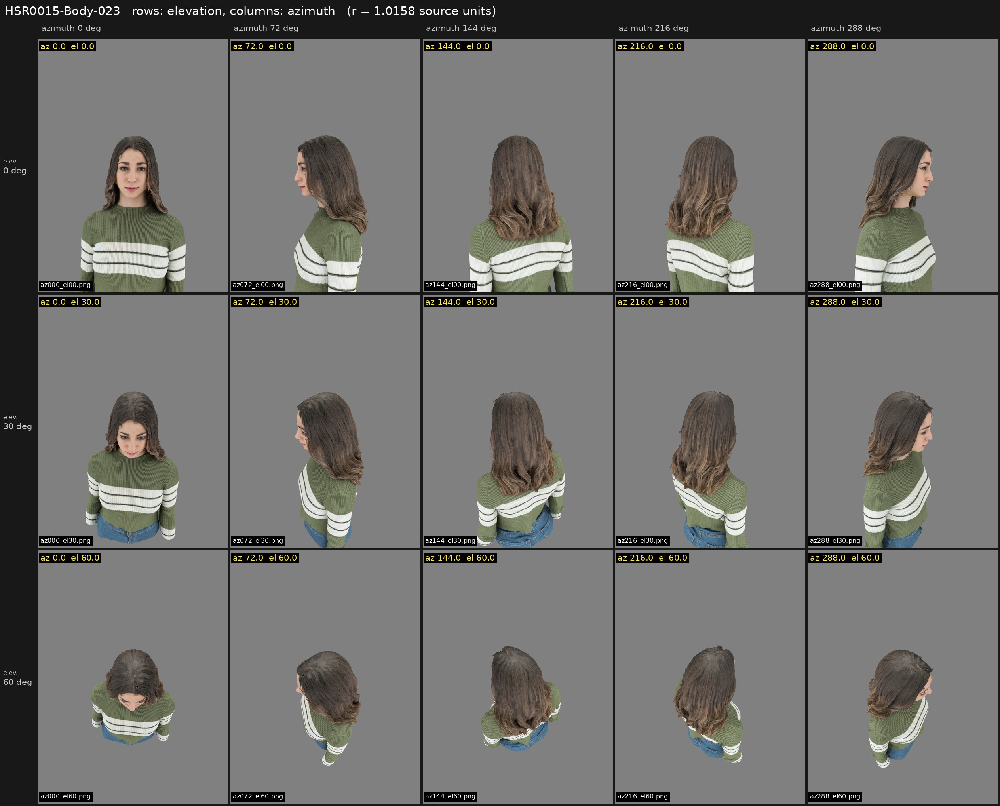
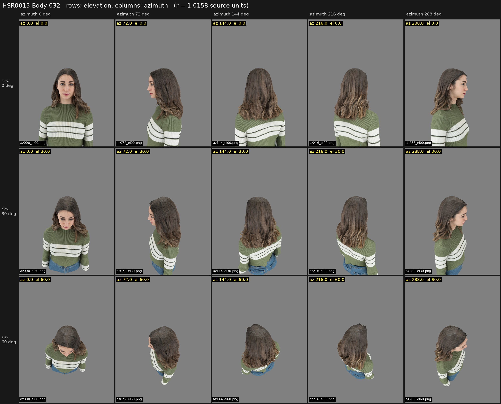
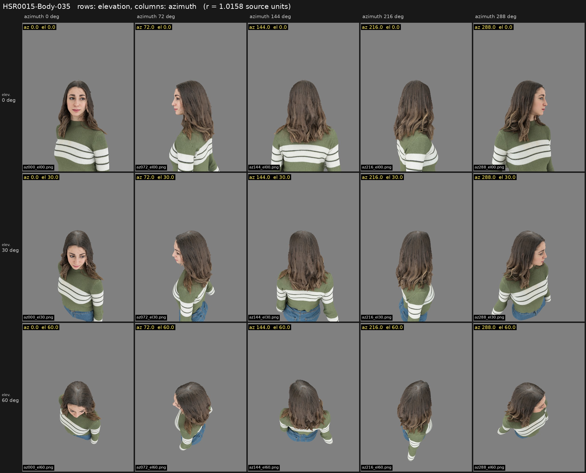
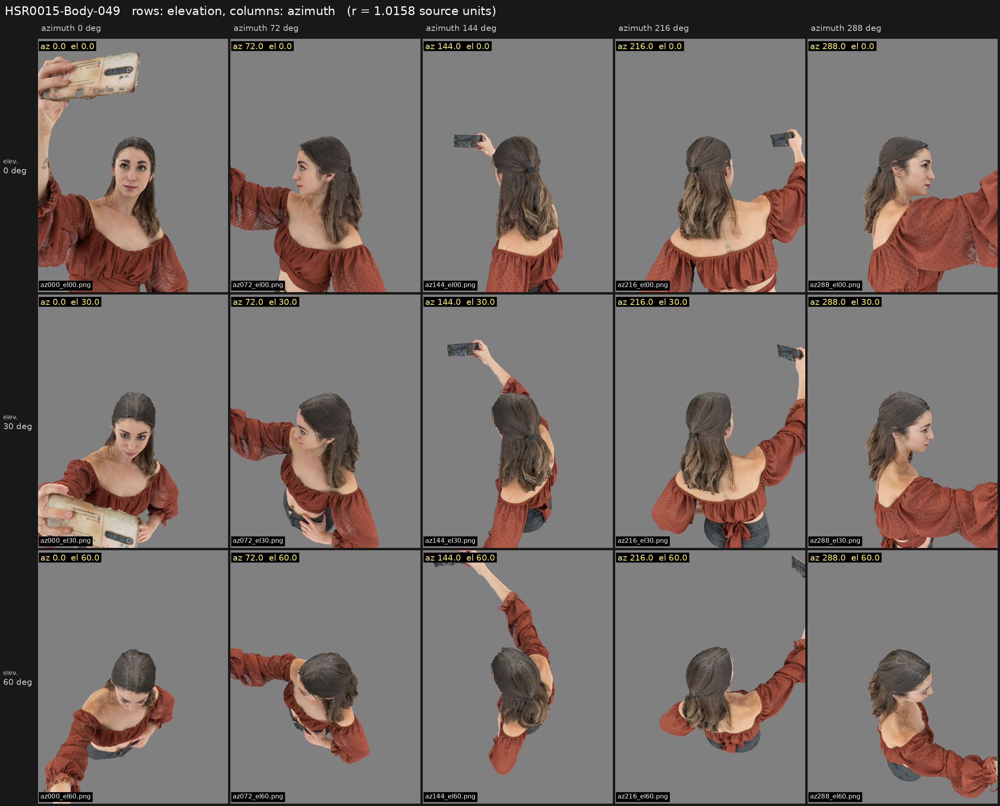
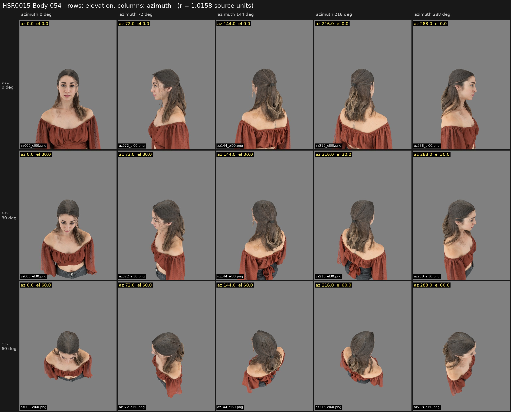
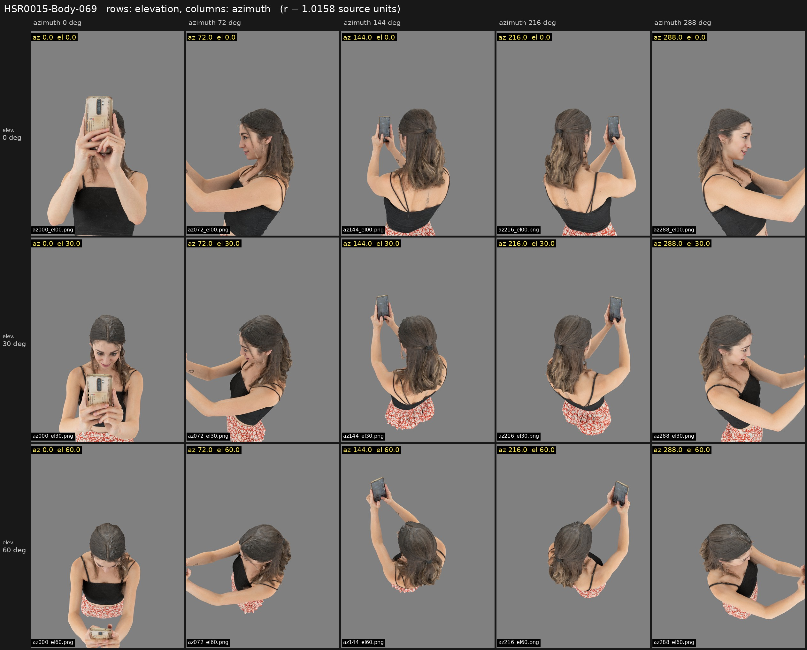
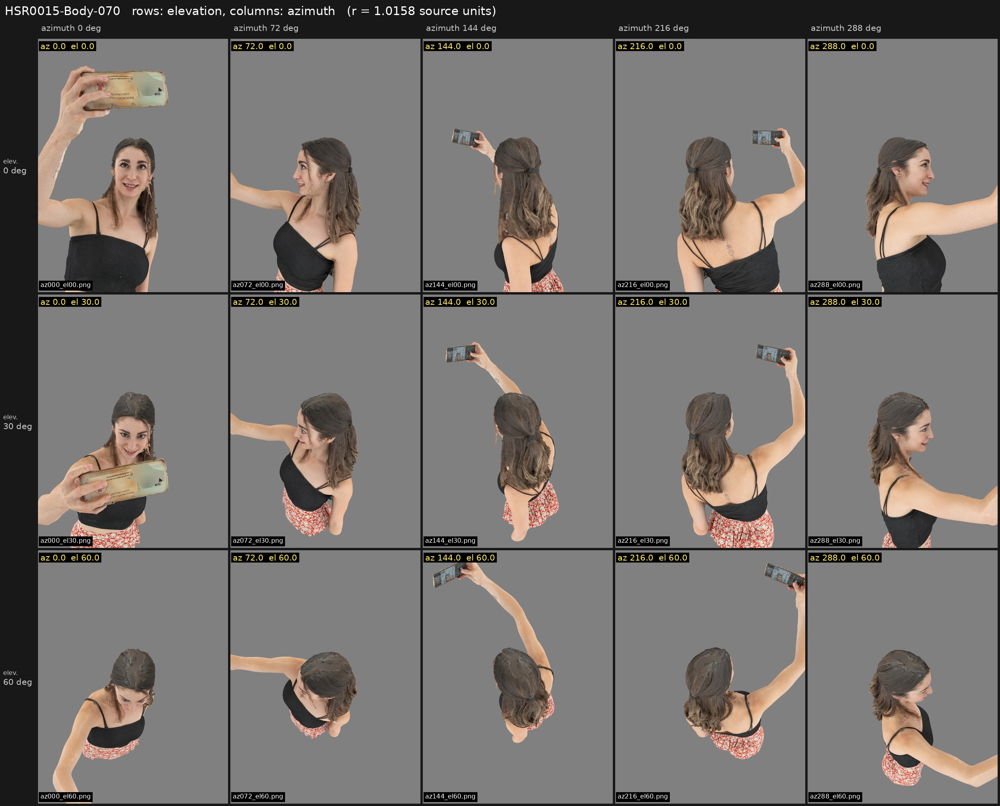
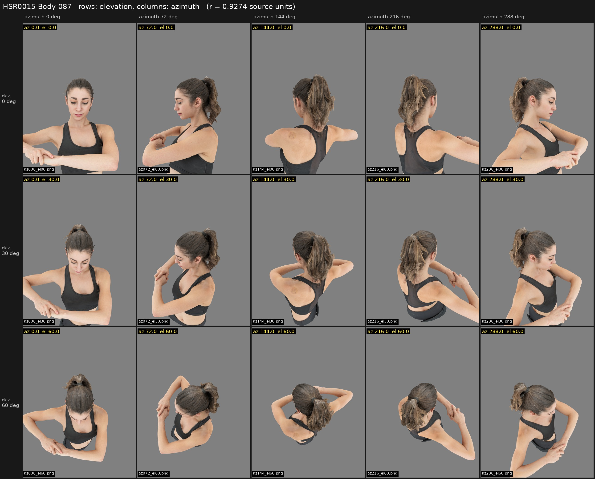

# HSR0015

[← 전체 목록](../README.md)

3D 스캔 8개, 이미지 120장. 그림을 누르면 그 스캔의 개별 이미지로 갑니다.

## [HSR0015-Body-023](HSR0015-Body-023/README.md)

## [HSR0015-Body-032](HSR0015-Body-032/README.md)

## [HSR0015-Body-035](HSR0015-Body-035/README.md)

## [HSR0015-Body-049](HSR0015-Body-049/README.md)

## [HSR0015-Body-054](HSR0015-Body-054/README.md)

## [HSR0015-Body-069](HSR0015-Body-069/README.md)

## [HSR0015-Body-070](HSR0015-Body-070/README.md)

## [HSR0015-Body-087](HSR0015-Body-087/README.md)

