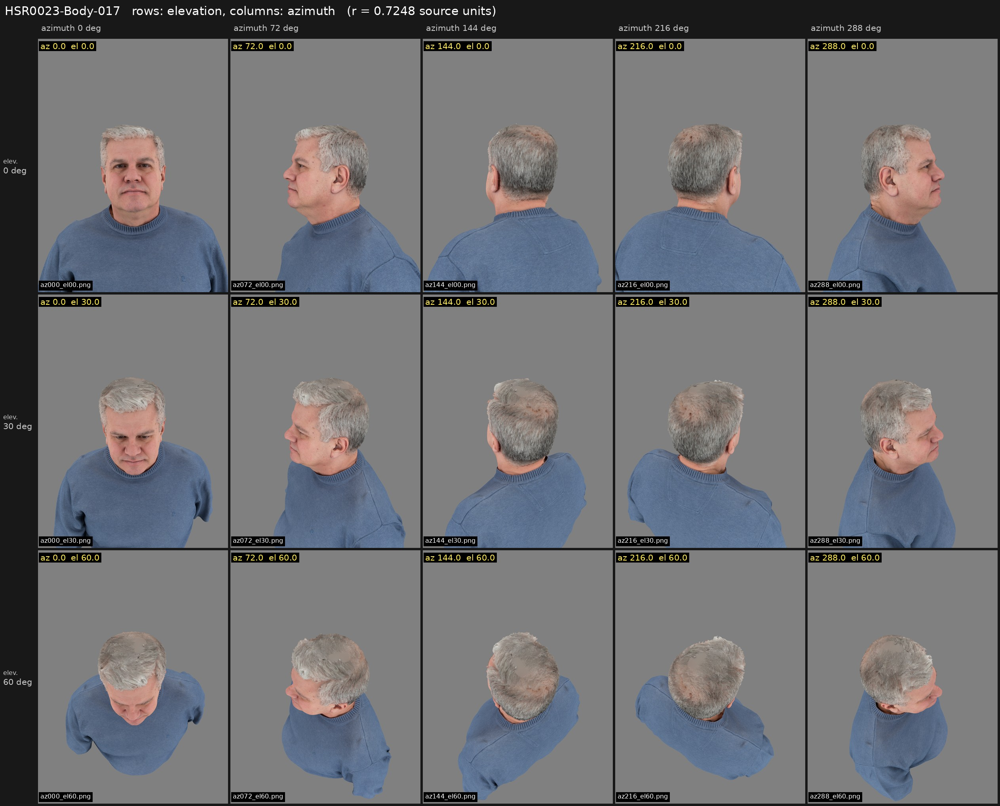
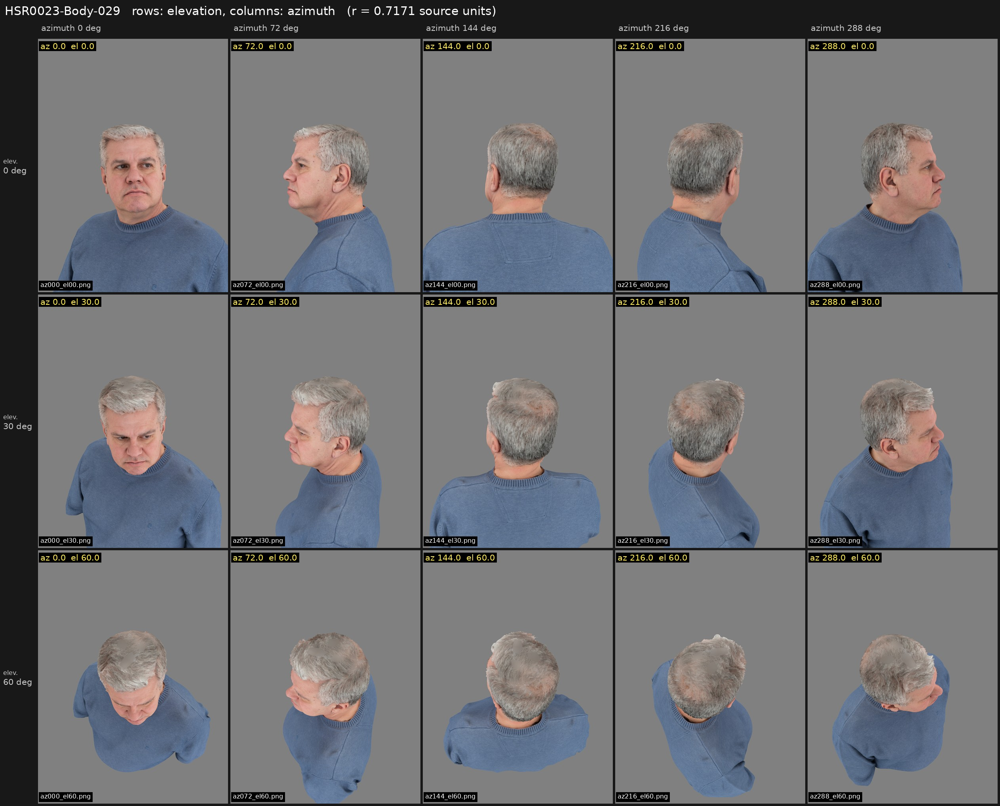
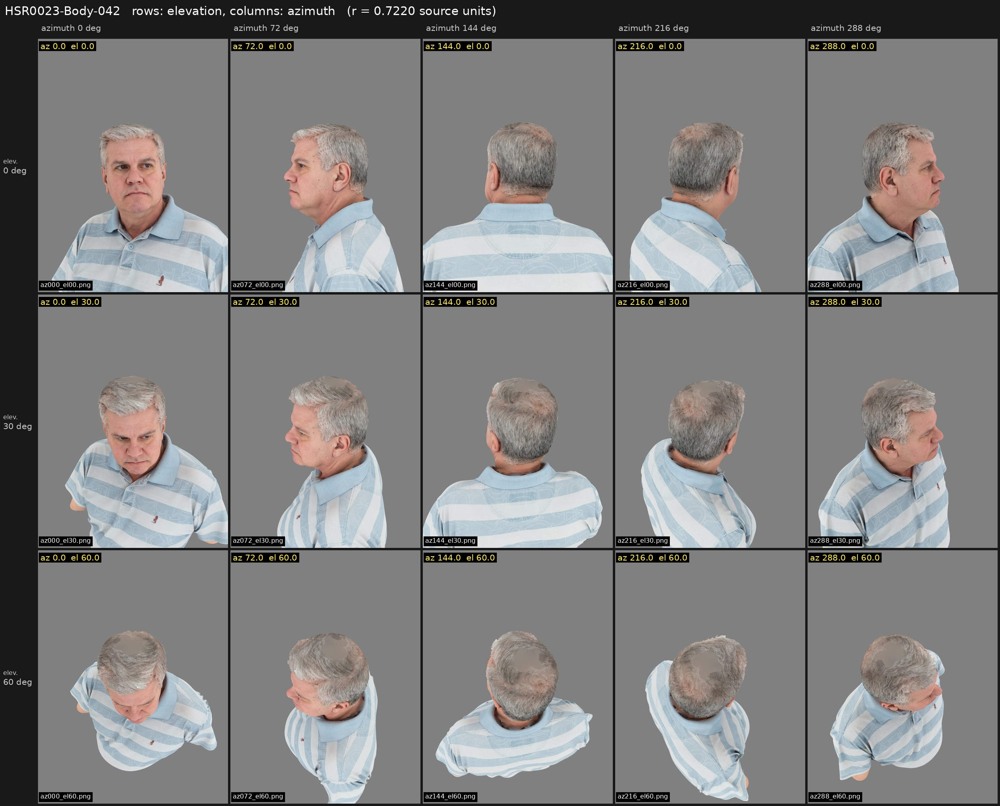
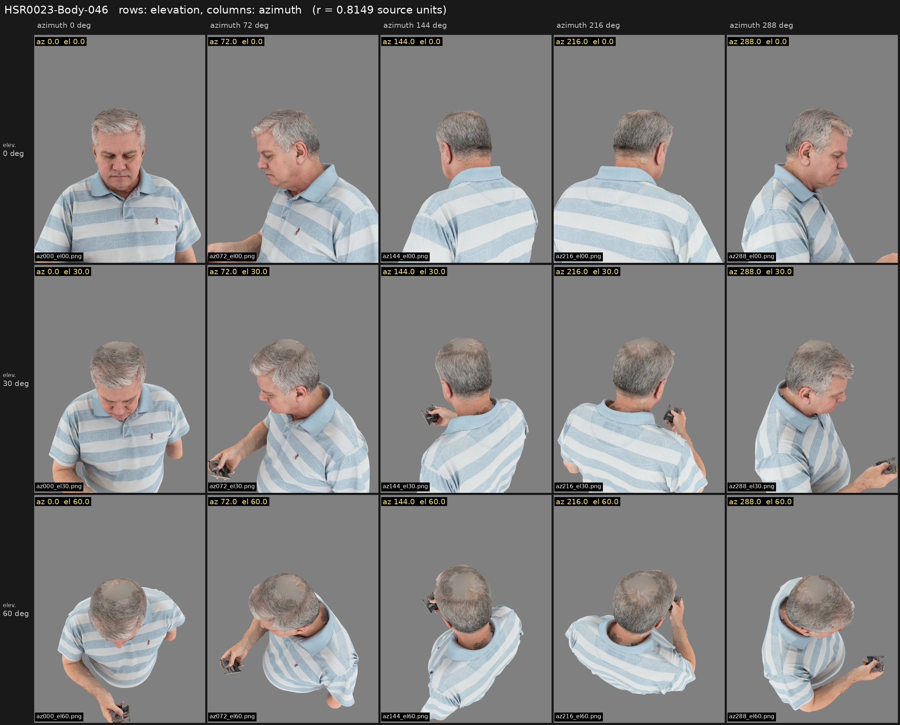
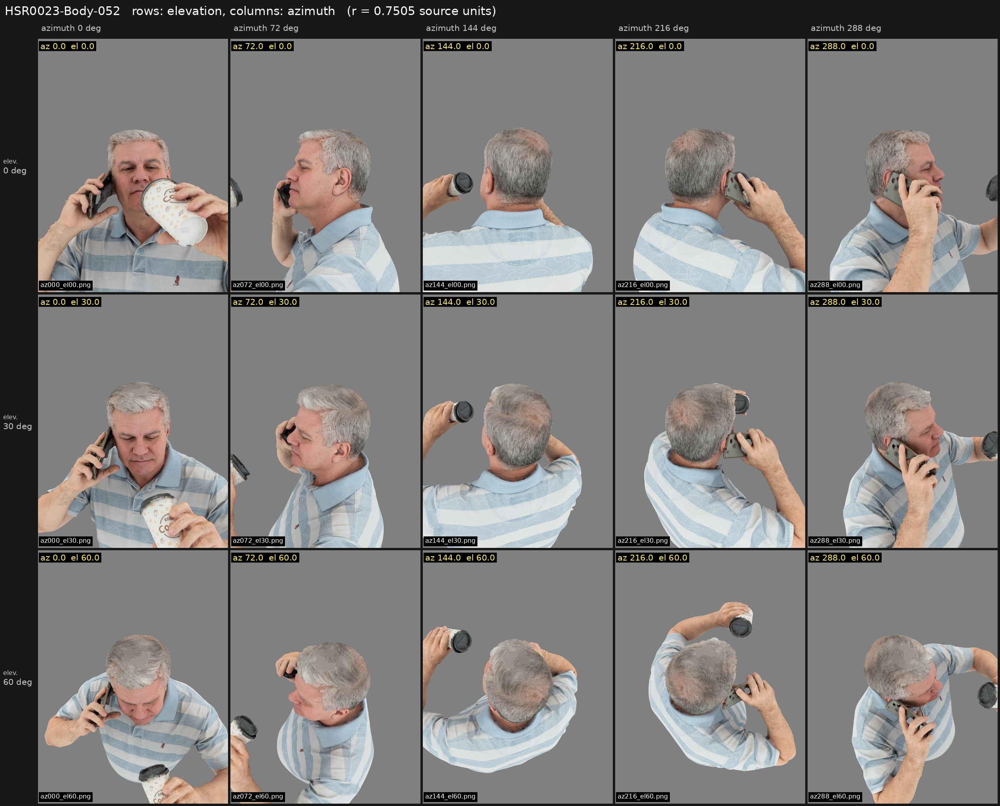
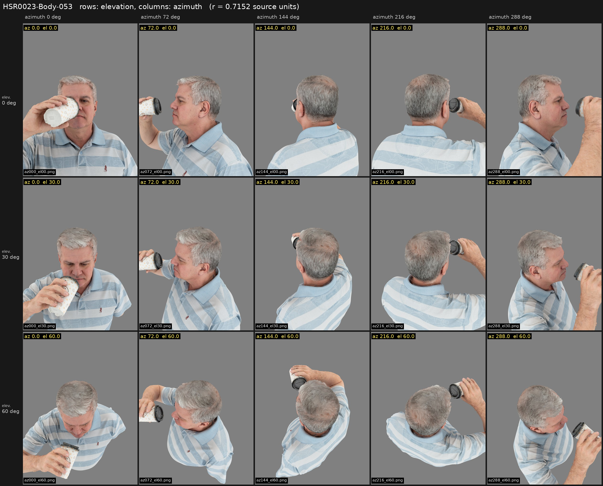
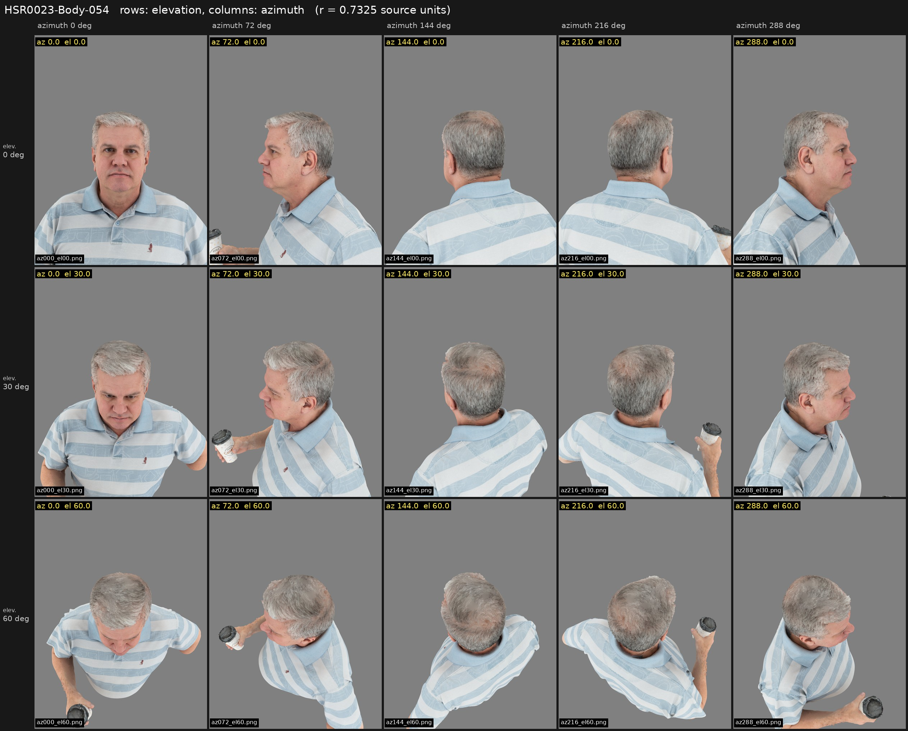
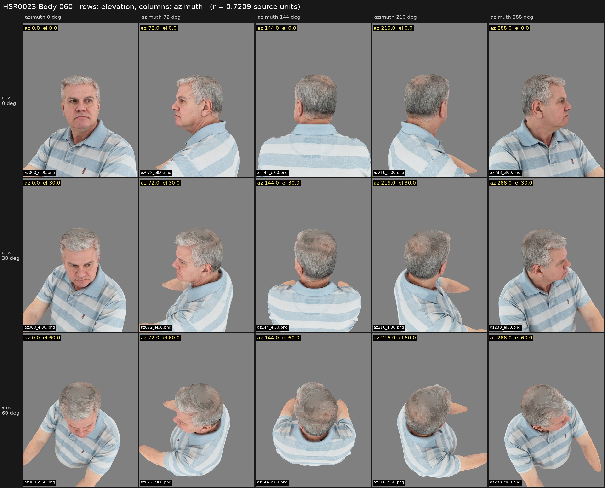
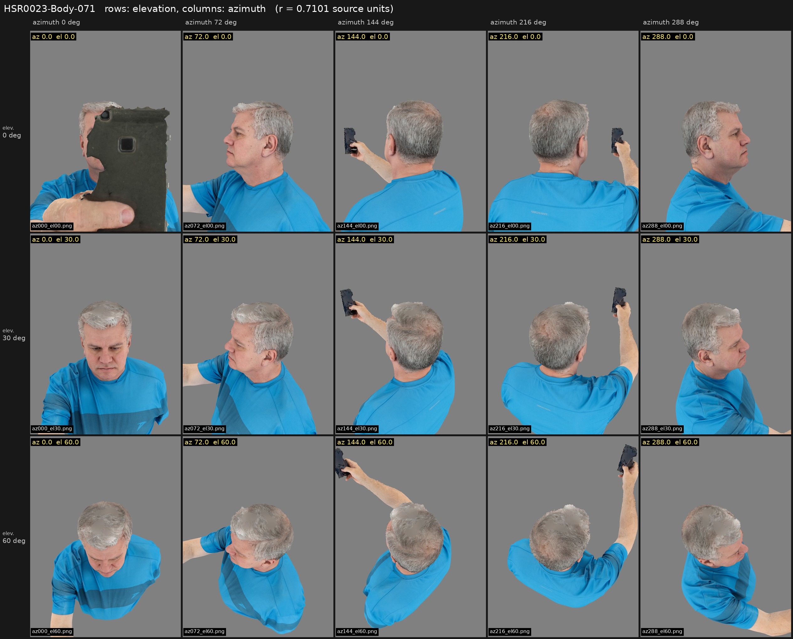
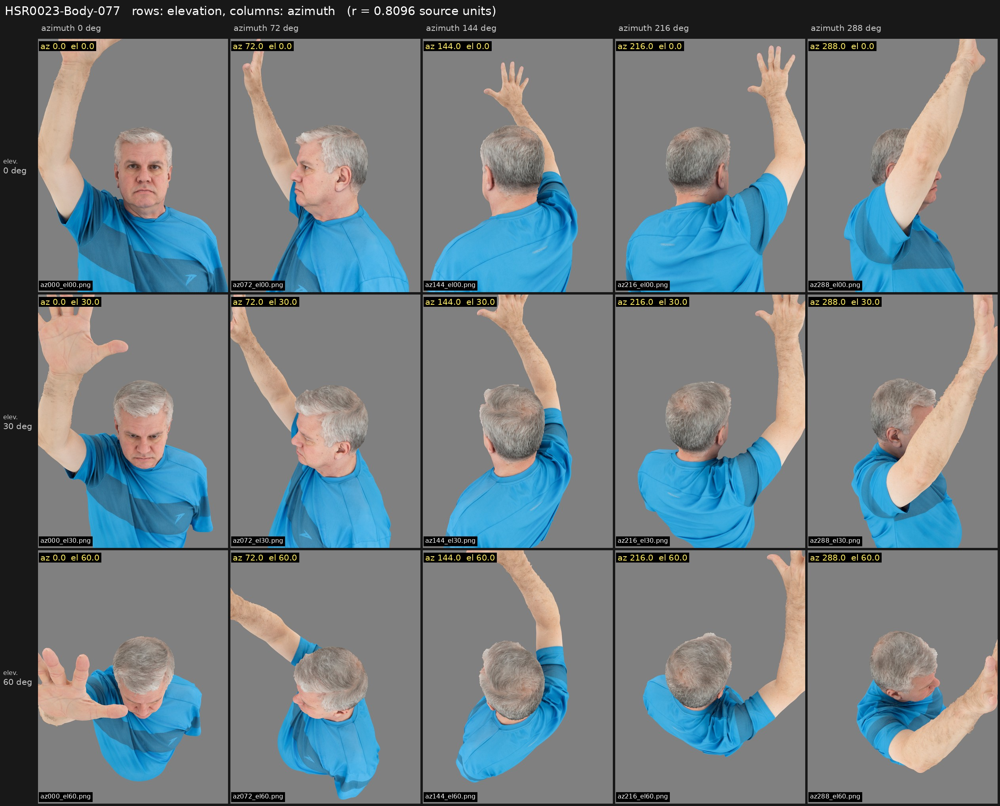

# HSR0023

[← 전체 목록](../README.md)

3D 스캔 10개, 이미지 150장. 그림을 누르면 그 스캔의 개별 이미지로 갑니다.

## [HSR0023-Body-017](HSR0023-Body-017/README.md)

## [HSR0023-Body-029](HSR0023-Body-029/README.md)

## [HSR0023-Body-042](HSR0023-Body-042/README.md)

## [HSR0023-Body-046](HSR0023-Body-046/README.md)

## [HSR0023-Body-052](HSR0023-Body-052/README.md)

## [HSR0023-Body-053](HSR0023-Body-053/README.md)

## [HSR0023-Body-054](HSR0023-Body-054/README.md)

## [HSR0023-Body-060](HSR0023-Body-060/README.md)

## [HSR0023-Body-071](HSR0023-Body-071/README.md)

## [HSR0023-Body-077](HSR0023-Body-077/README.md)

