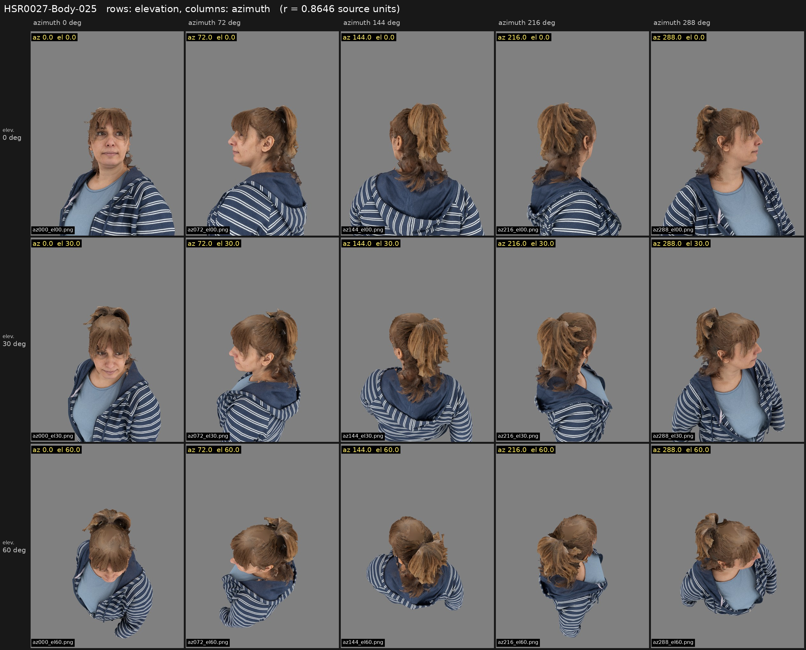
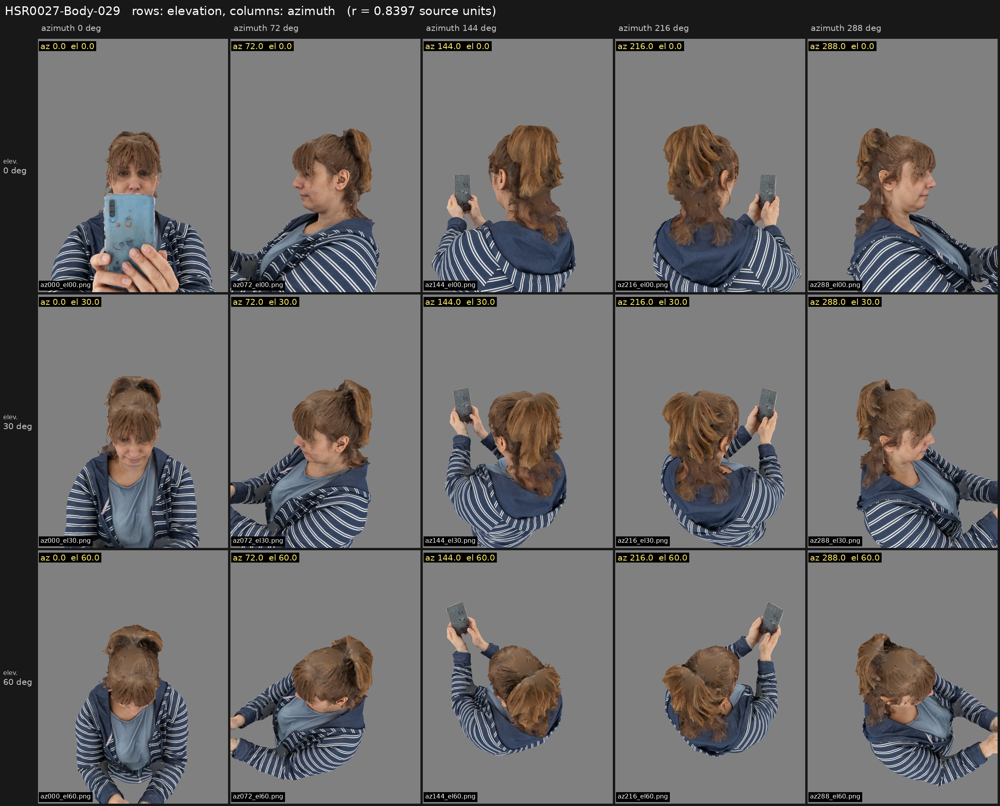
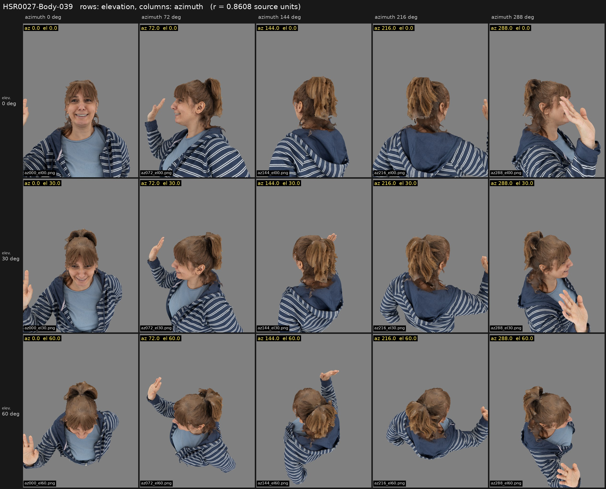
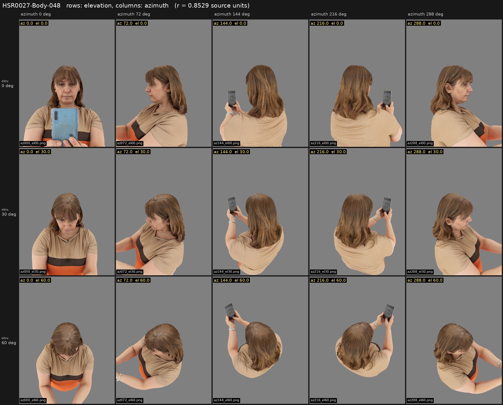
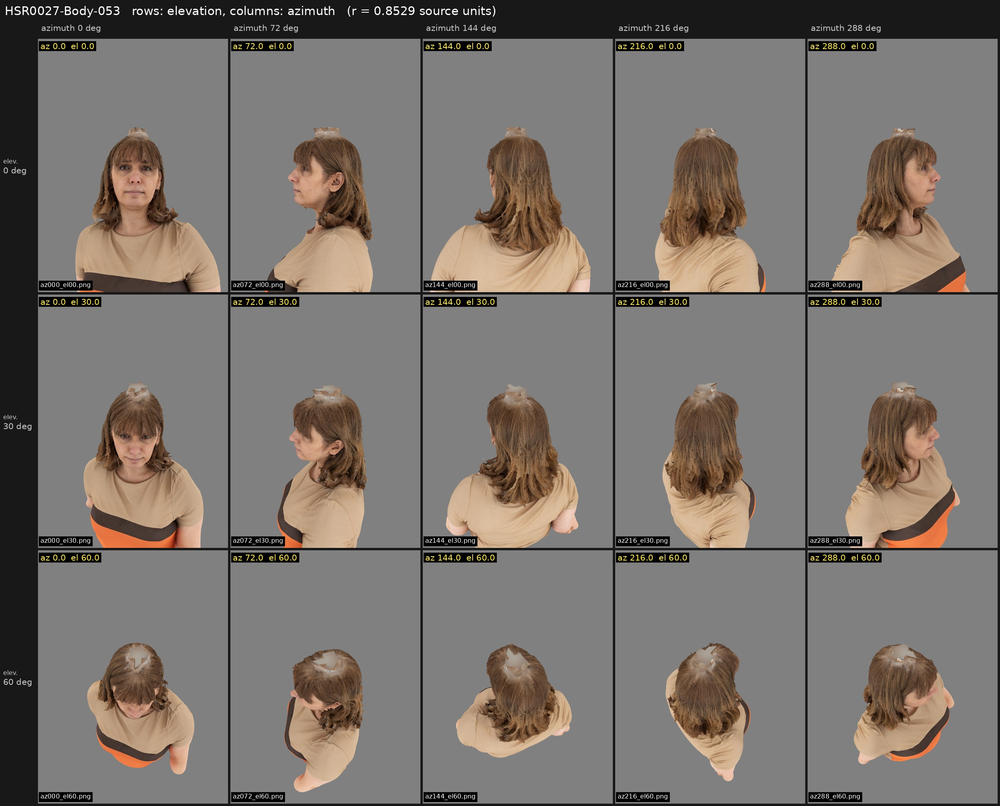
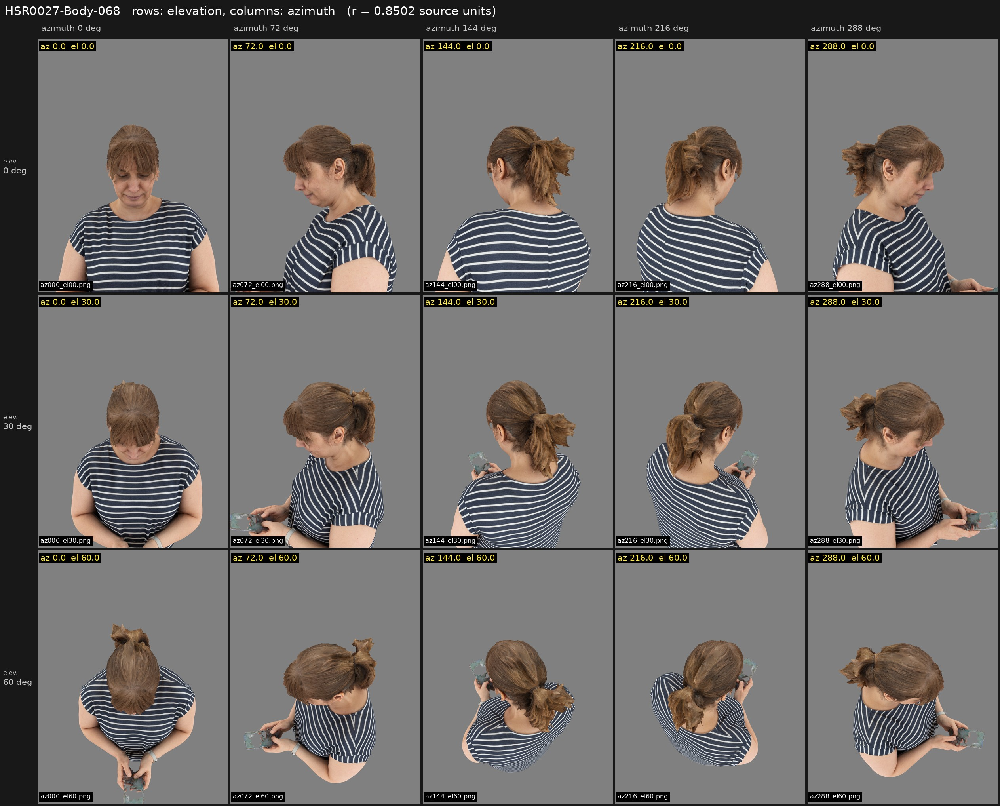

# HSR0027

[← 전체 목록](../README.md)

3D 스캔 6개, 이미지 90장. 그림을 누르면 그 스캔의 개별 이미지로 갑니다.

## [HSR0027-Body-025](HSR0027-Body-025/README.md)

## [HSR0027-Body-029](HSR0027-Body-029/README.md)

## [HSR0027-Body-039](HSR0027-Body-039/README.md)

## [HSR0027-Body-048](HSR0027-Body-048/README.md)

## [HSR0027-Body-053](HSR0027-Body-053/README.md)

## [HSR0027-Body-068](HSR0027-Body-068/README.md)

