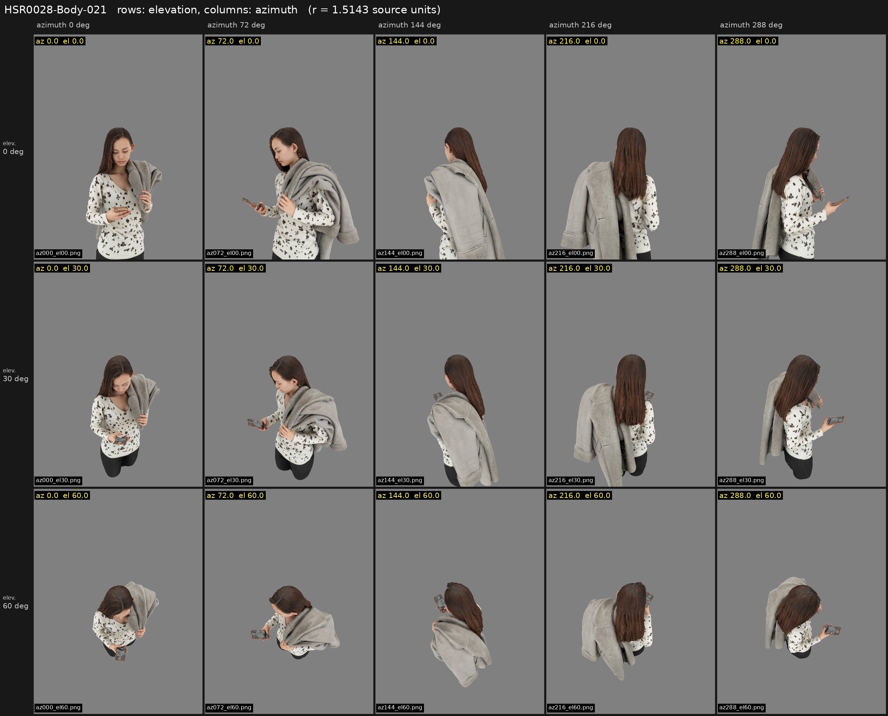
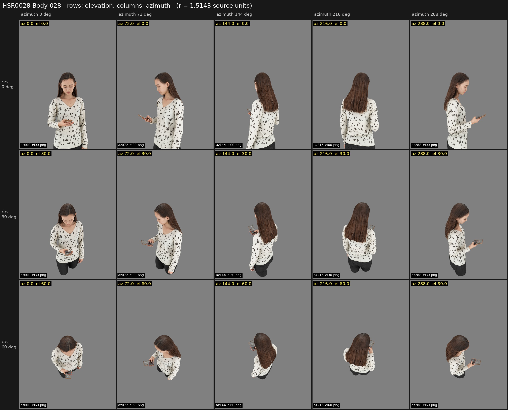
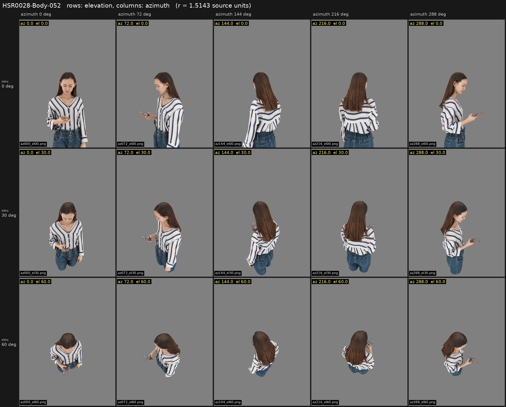
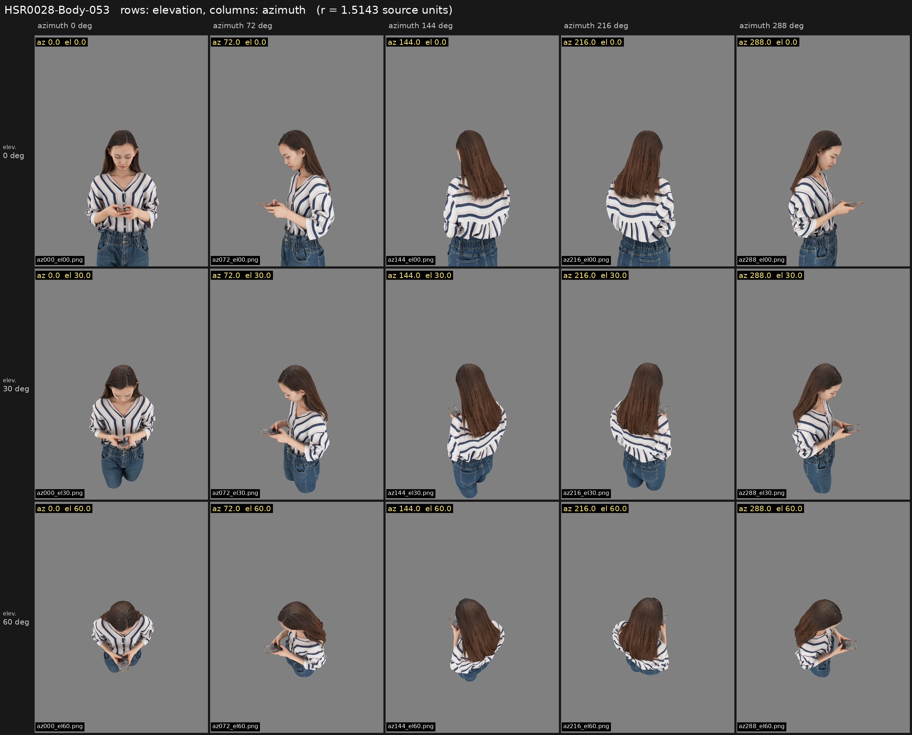
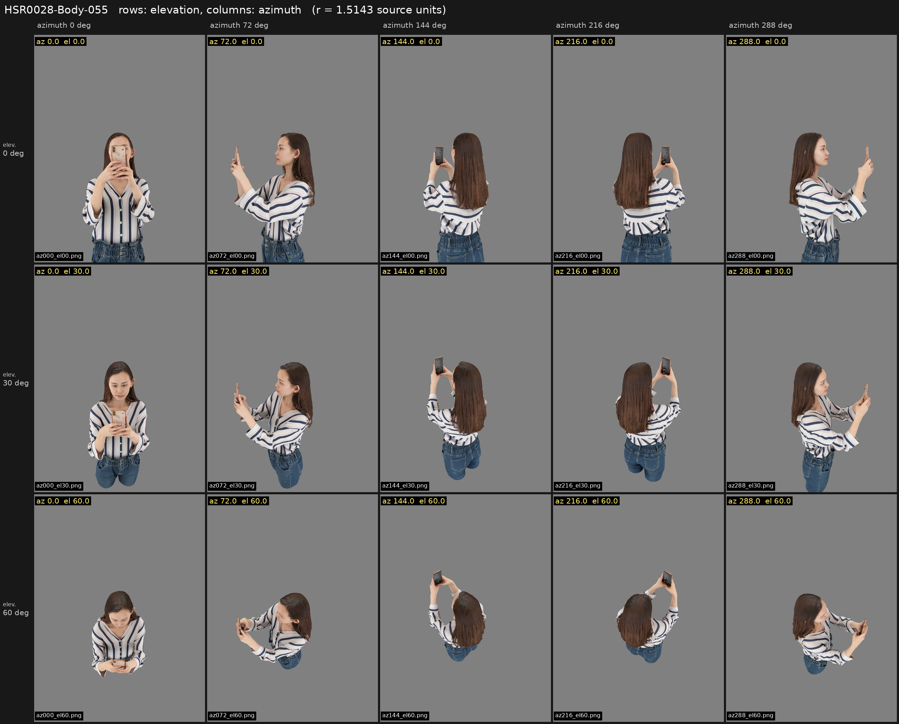
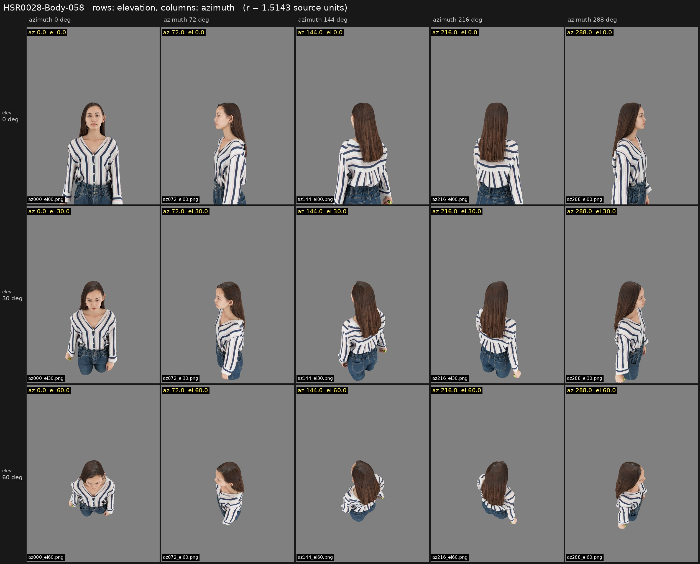
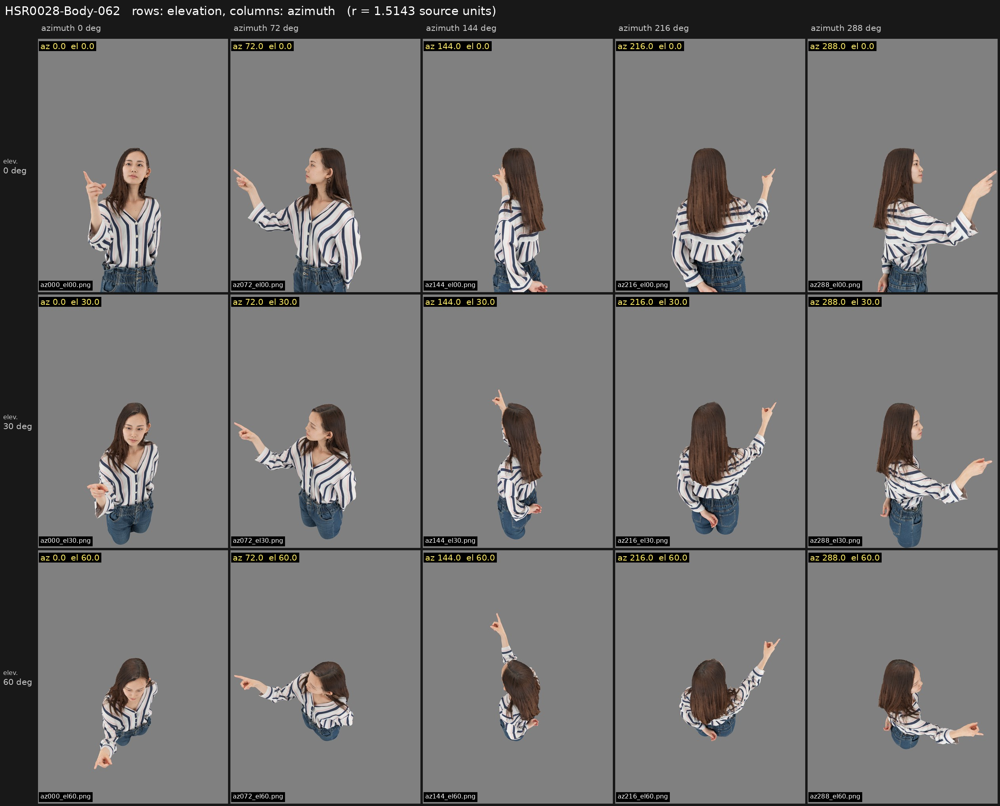
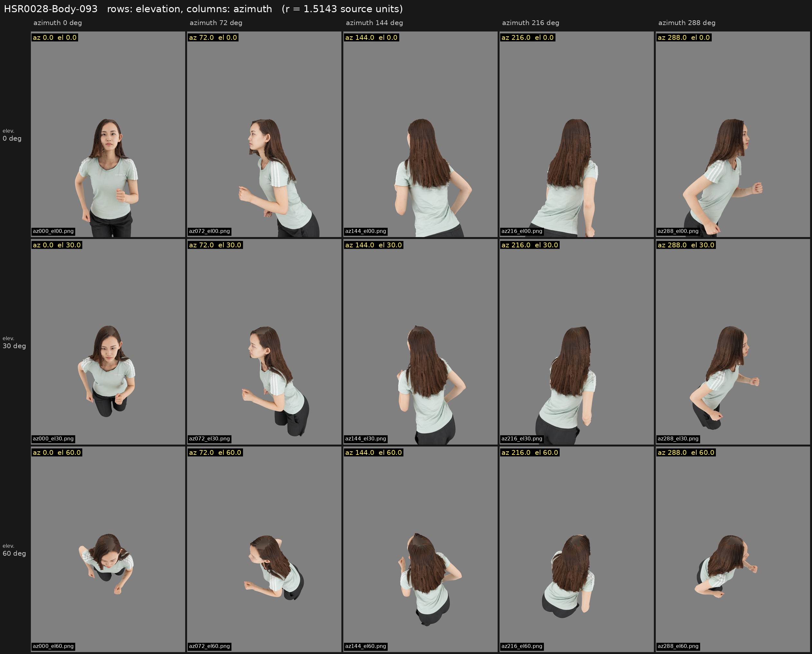

# HSR0028

[← 전체 목록](../README.md)

3D 스캔 8개, 이미지 120장. 그림을 누르면 그 스캔의 개별 이미지로 갑니다.

## [HSR0028-Body-021](HSR0028-Body-021/README.md)

## [HSR0028-Body-028](HSR0028-Body-028/README.md)

## [HSR0028-Body-052](HSR0028-Body-052/README.md)

## [HSR0028-Body-053](HSR0028-Body-053/README.md)

## [HSR0028-Body-055](HSR0028-Body-055/README.md)

## [HSR0028-Body-058](HSR0028-Body-058/README.md)

## [HSR0028-Body-062](HSR0028-Body-062/README.md)

## [HSR0028-Body-093](HSR0028-Body-093/README.md)

