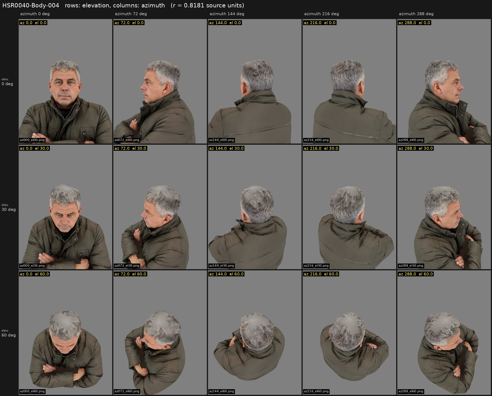
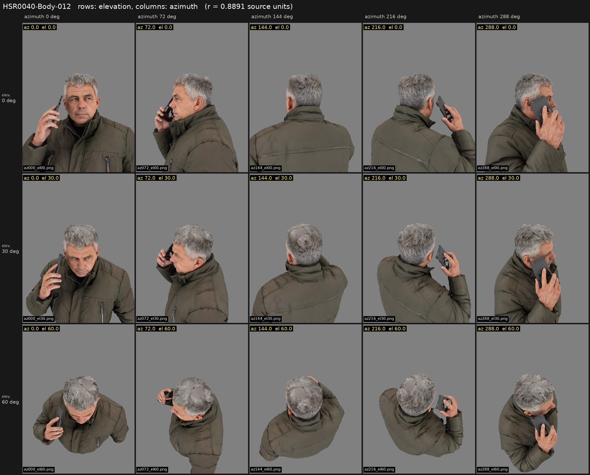
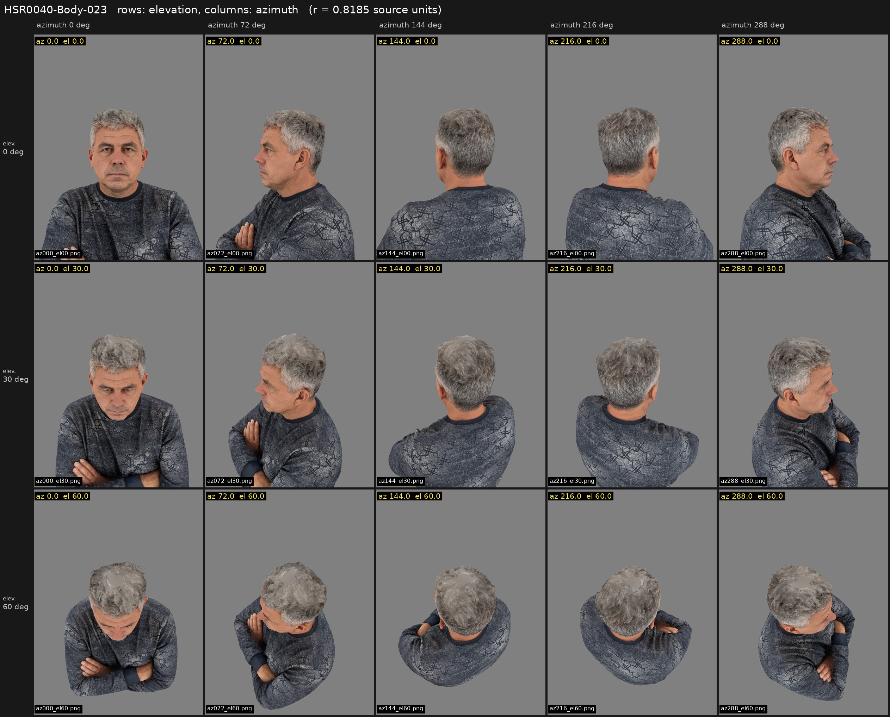
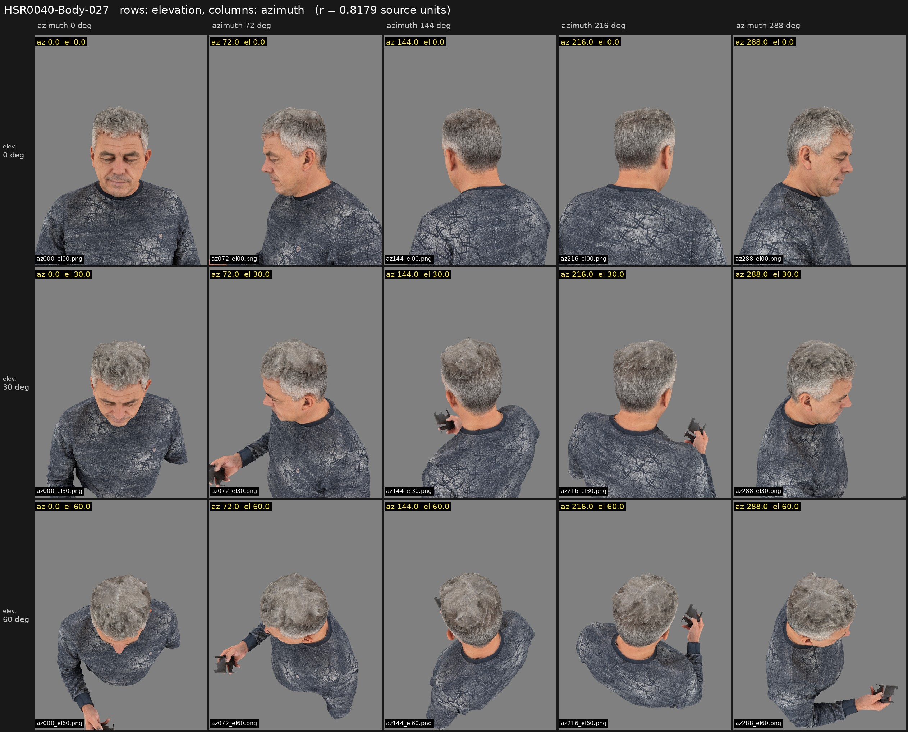
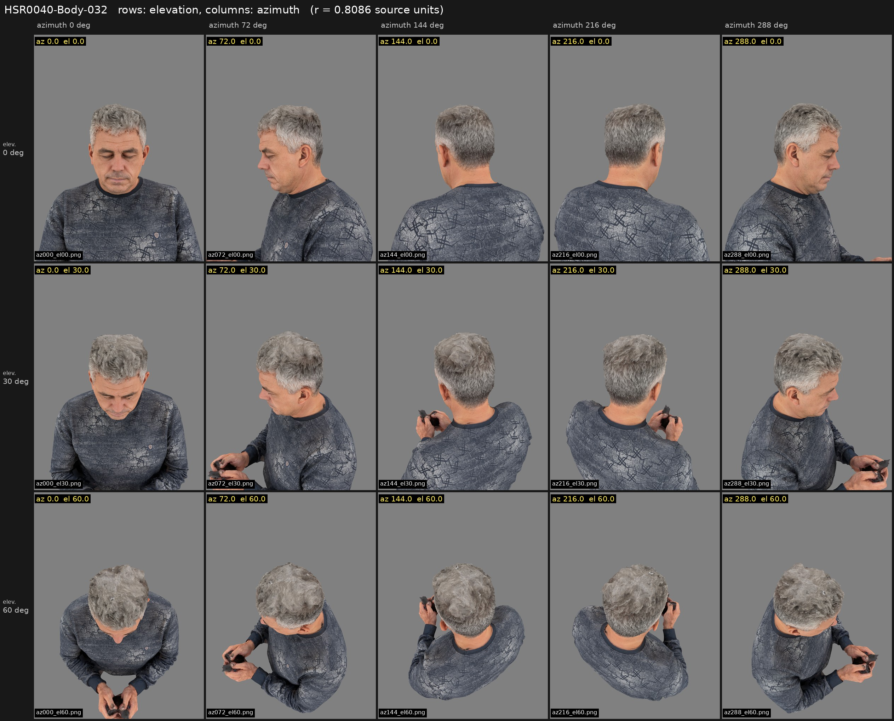
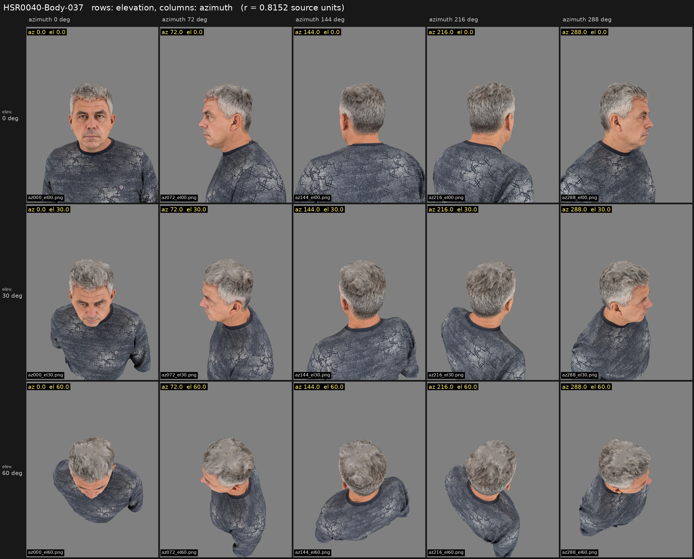
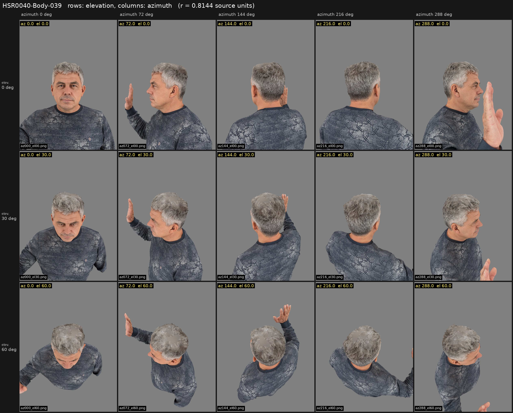
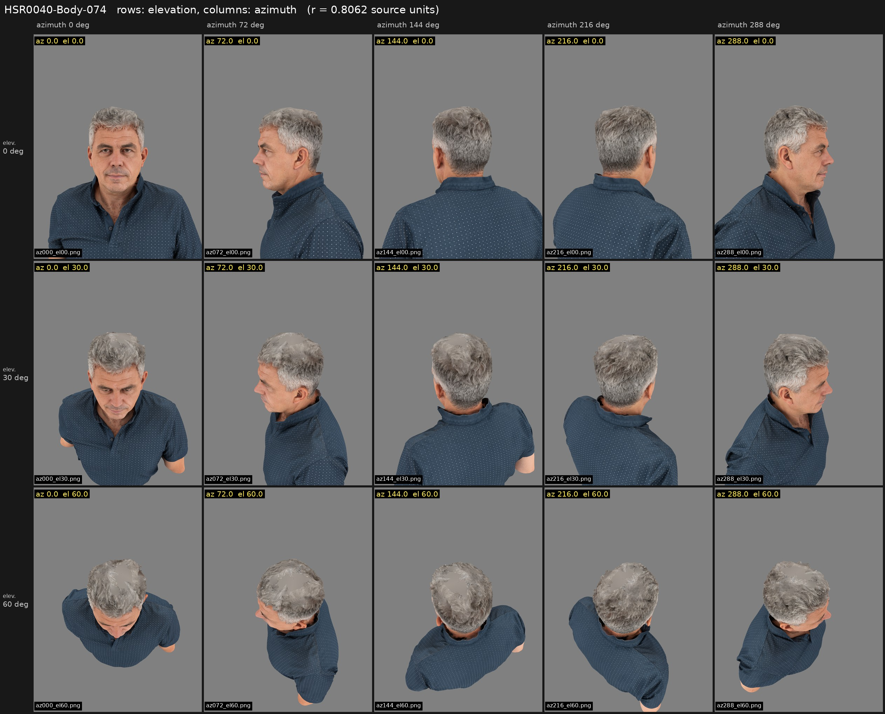
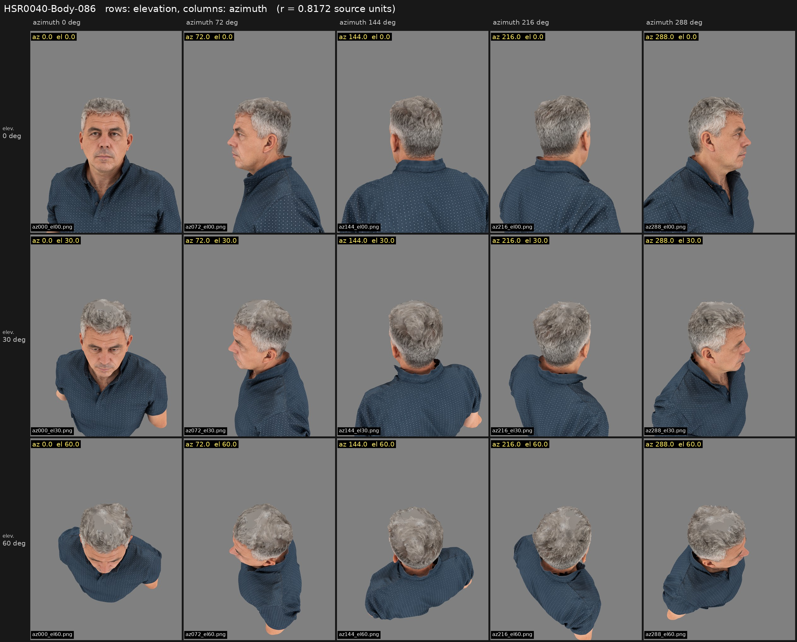

# HSR0040

[← 전체 목록](../README.md)

3D 스캔 9개, 이미지 135장. 그림을 누르면 그 스캔의 개별 이미지로 갑니다.

## [HSR0040-Body-004](HSR0040-Body-004/README.md)

## [HSR0040-Body-012](HSR0040-Body-012/README.md)

## [HSR0040-Body-023](HSR0040-Body-023/README.md)

## [HSR0040-Body-027](HSR0040-Body-027/README.md)

## [HSR0040-Body-032](HSR0040-Body-032/README.md)

## [HSR0040-Body-037](HSR0040-Body-037/README.md)

## [HSR0040-Body-039](HSR0040-Body-039/README.md)

## [HSR0040-Body-074](HSR0040-Body-074/README.md)

## [HSR0040-Body-086](HSR0040-Body-086/README.md)

