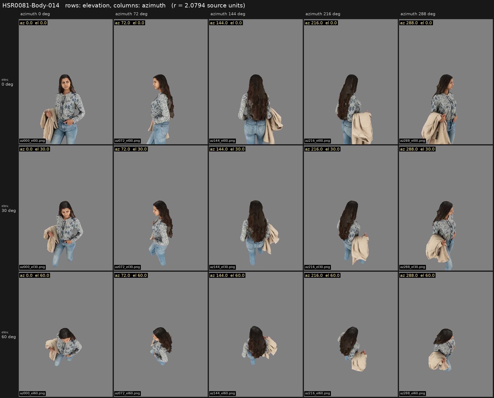
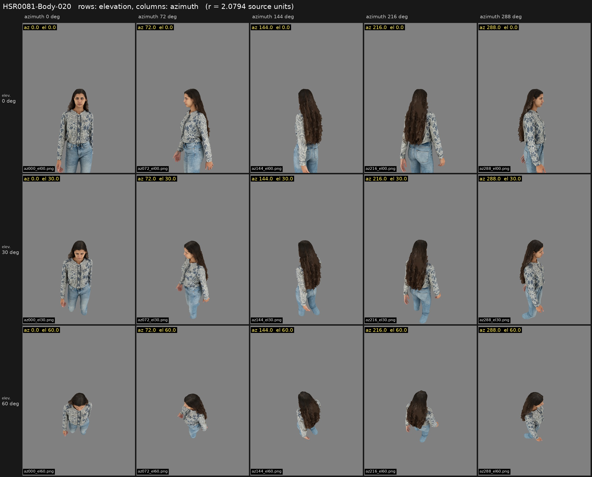
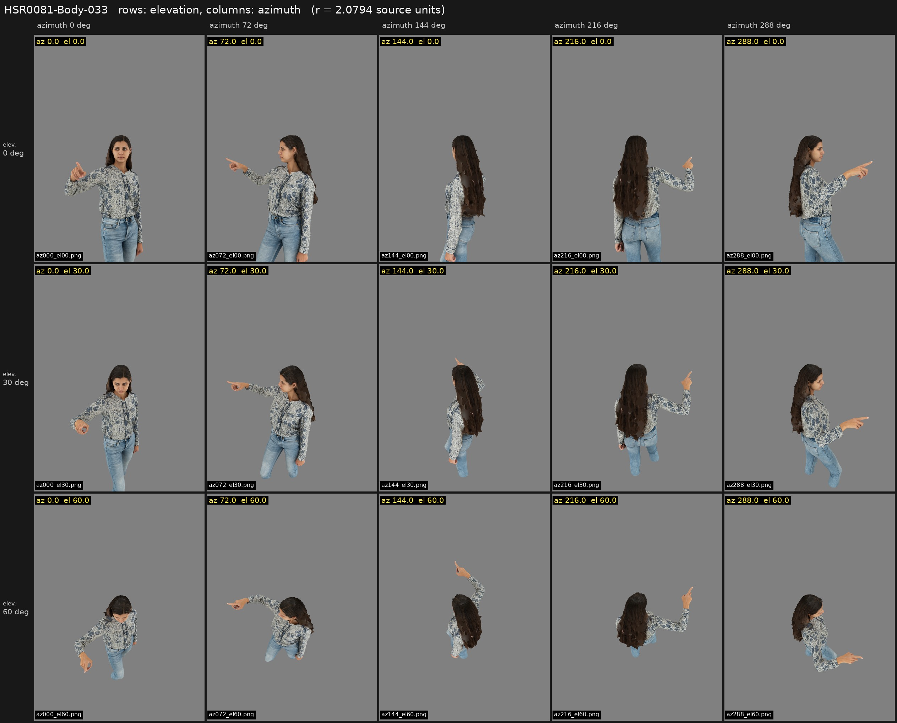
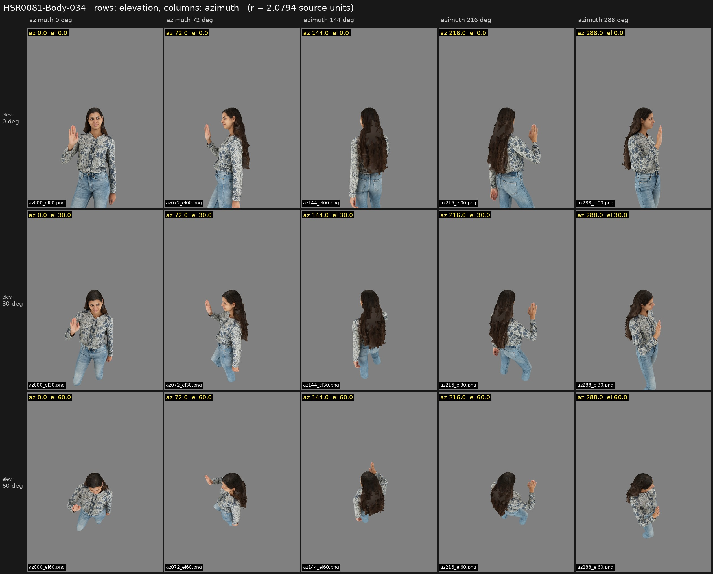
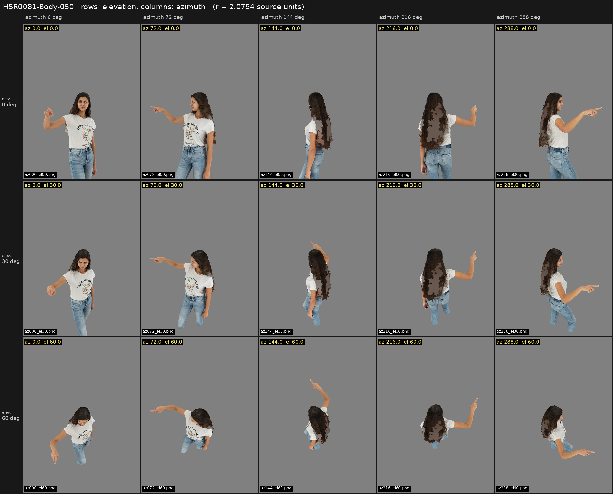
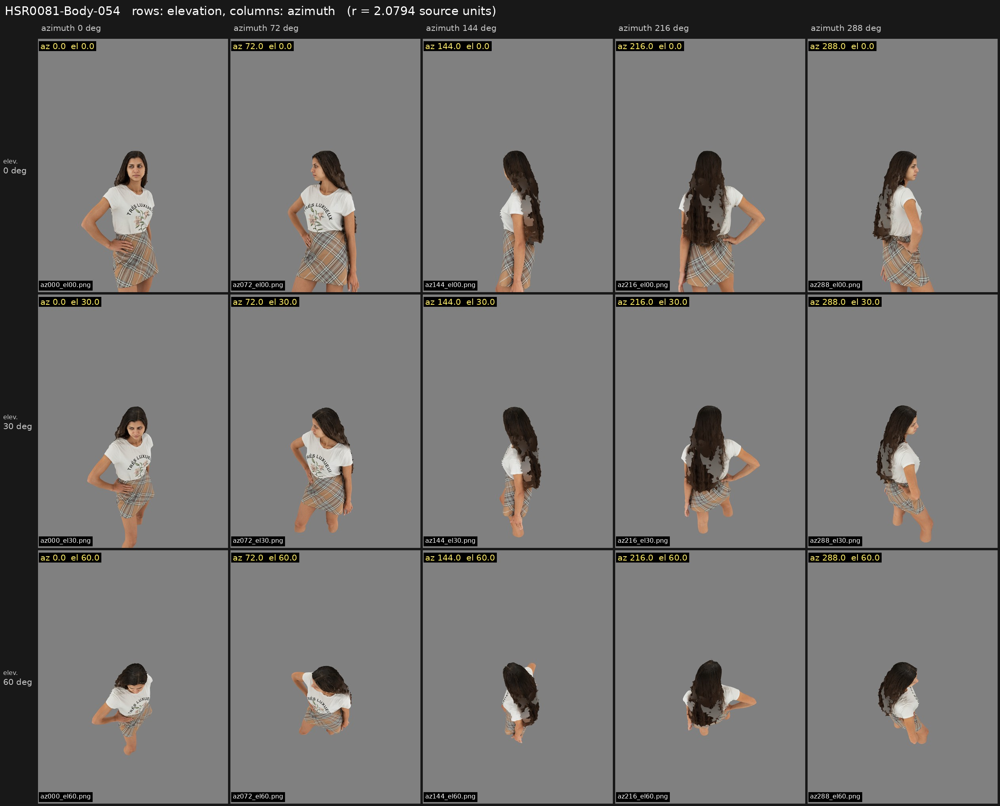
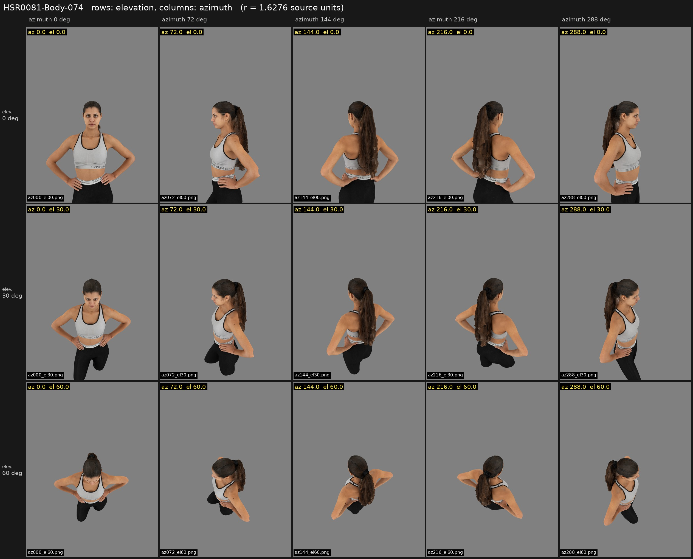

# HSR0081

[← 전체 목록](../README.md)

3D 스캔 7개, 이미지 105장. 그림을 누르면 그 스캔의 개별 이미지로 갑니다.

## [HSR0081-Body-014](HSR0081-Body-014/README.md)

## [HSR0081-Body-020](HSR0081-Body-020/README.md)

## [HSR0081-Body-033](HSR0081-Body-033/README.md)

## [HSR0081-Body-034](HSR0081-Body-034/README.md)

## [HSR0081-Body-050](HSR0081-Body-050/README.md)

## [HSR0081-Body-054](HSR0081-Body-054/README.md)

## [HSR0081-Body-074](HSR0081-Body-074/README.md)

