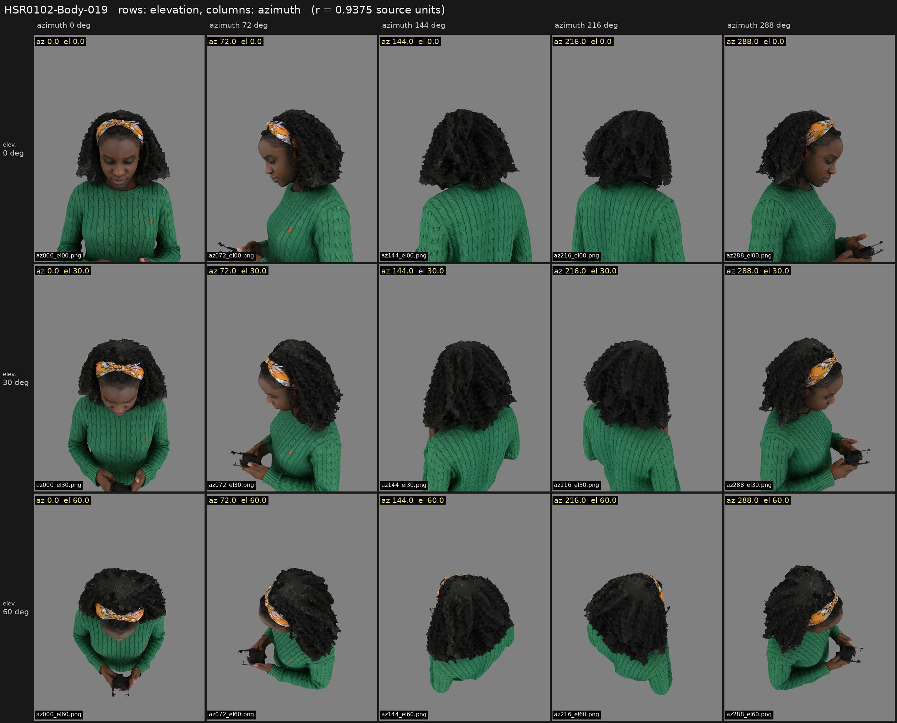

# HSR0102-Body-019

[← HSR0102](../README.md) · [전체 목록](../../README.md)

3D 스캔 [HSR0102-Body-019-Scan-LOD0.zip](https://huggingface.co/datasets/digitalrealitylab/HSRD-100/resolve/9cc5e9c138dd310dc88c95c80e5db0a3ecb7971a/data/HSR0102/HSR0102-Body-019/scans/HSR0102-Body-019-Scan-LOD0.zip) 을 15개 시점에서 렌더링한 1200×1600 PNG 입니다.

| 고도각 ＼ 수평각 | 0° (정면) | 72° (피험자의 왼쪽 앞) | 144° (피험자의 왼쪽 뒤) | 216° (피험자의 오른쪽 뒤) | 288° (피험자의 오른쪽 앞) |
|---|---|---|---|---|---|
| **0°** | [az000_el00.png](images/az000_el00.png) | [az072_el00.png](images/az072_el00.png) | [az144_el00.png](images/az144_el00.png) | [az216_el00.png](images/az216_el00.png) | [az288_el00.png](images/az288_el00.png) |
| **30°** | [az000_el30.png](images/az000_el30.png) | [az072_el30.png](images/az072_el30.png) | [az144_el30.png](images/az144_el30.png) | [az216_el30.png](images/az216_el30.png) | [az288_el30.png](images/az288_el30.png) |
| **60°** | [az000_el60.png](images/az000_el60.png) | [az072_el60.png](images/az072_el60.png) | [az144_el60.png](images/az144_el60.png) | [az216_el60.png](images/az216_el60.png) | [az288_el60.png](images/az288_el60.png) |

카메라 파라미터: [cameras.json](cameras.json) · 3D 스캔 출처: [source.json](source.json)
