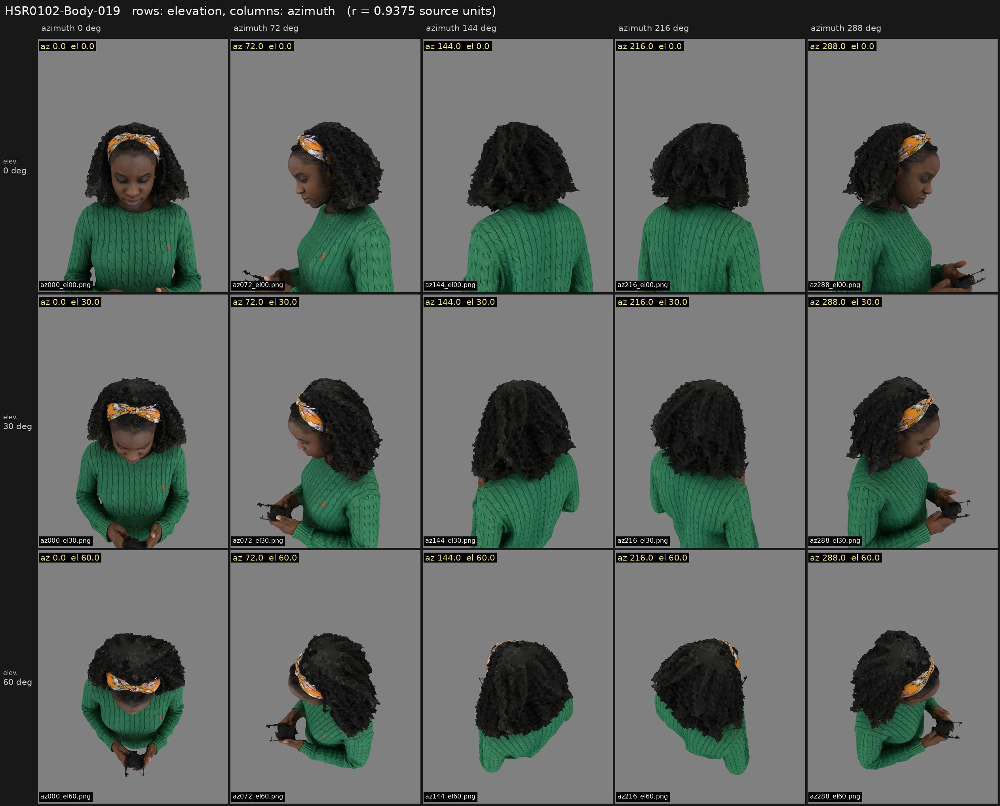
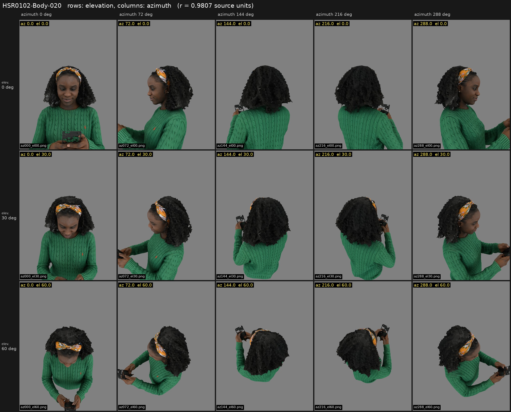
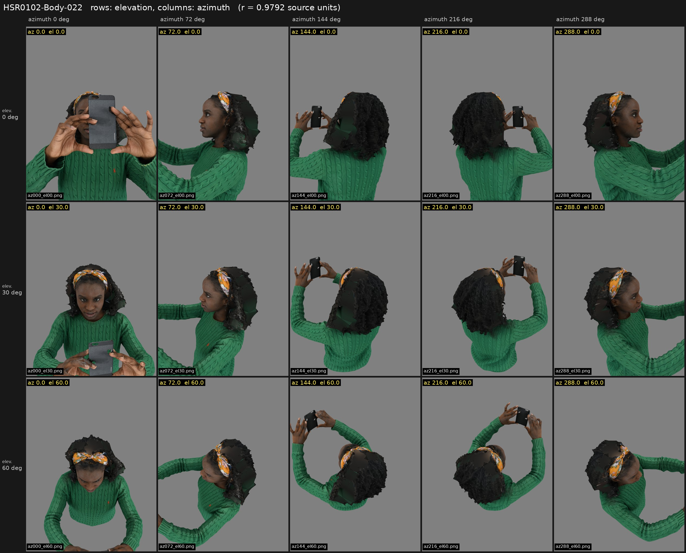
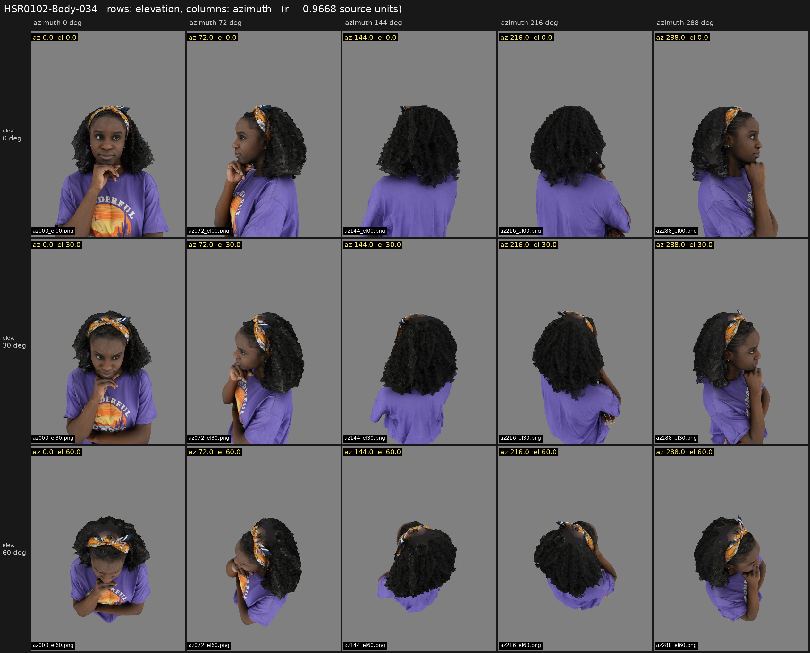
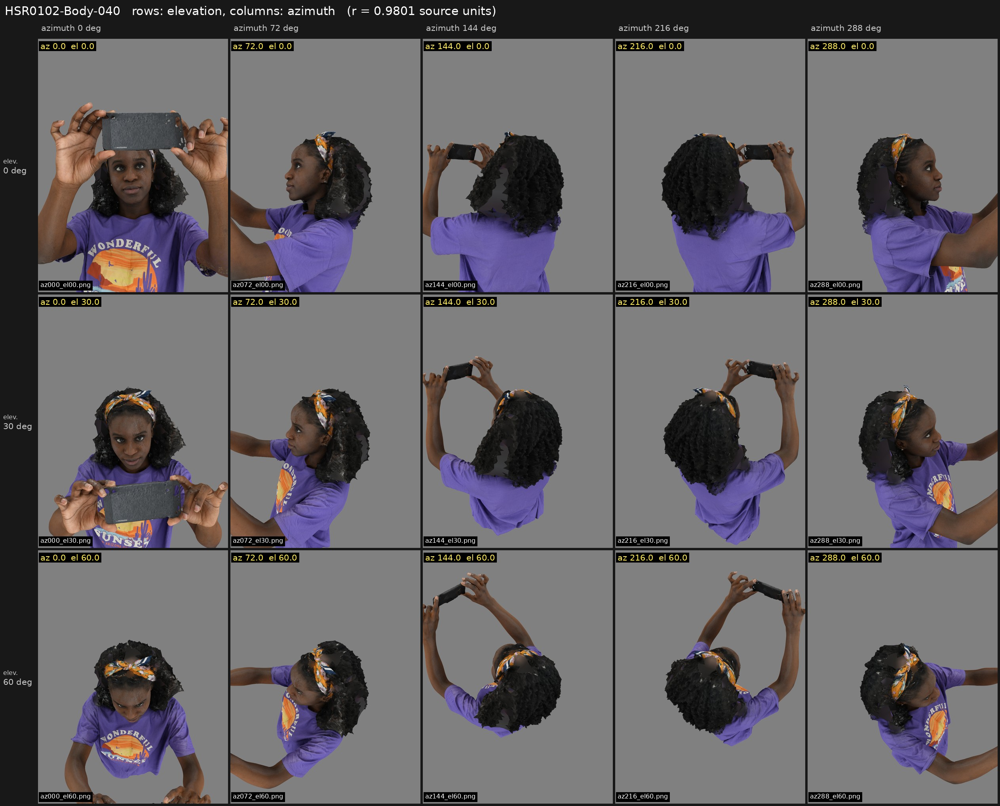
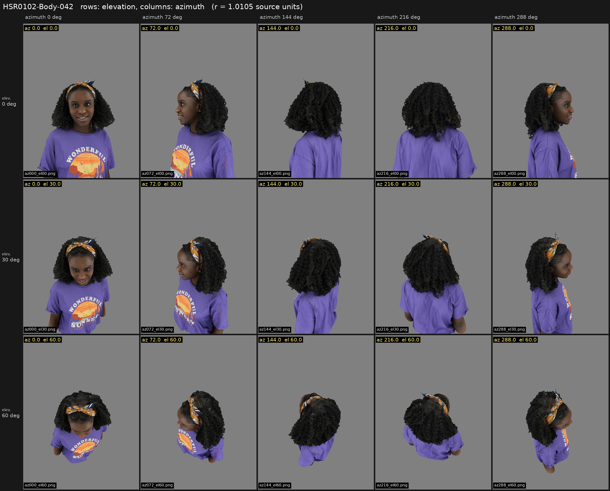
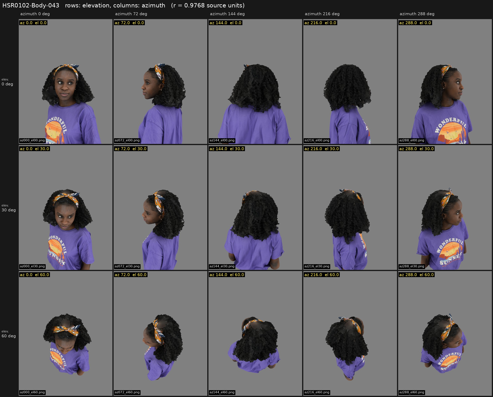
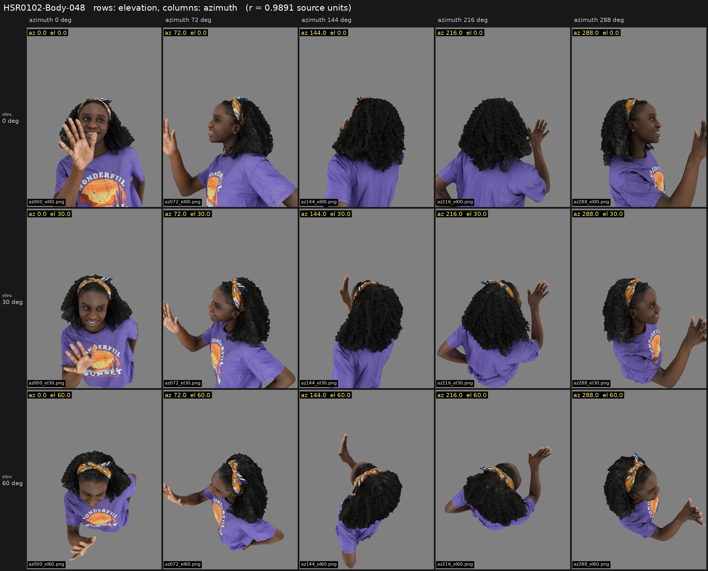
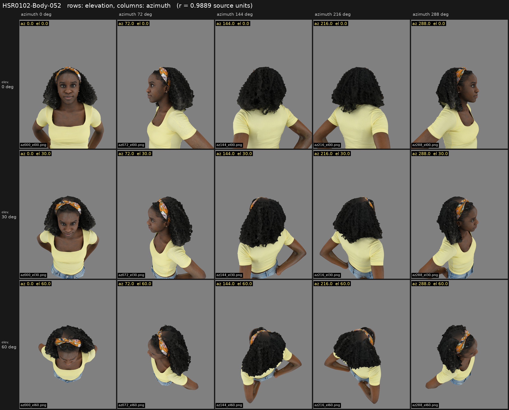

# HSR0102

[← 전체 목록](../README.md)

3D 스캔 9개, 이미지 135장. 그림을 누르면 그 스캔의 개별 이미지로 갑니다.

## [HSR0102-Body-019](HSR0102-Body-019/README.md)

## [HSR0102-Body-020](HSR0102-Body-020/README.md)

## [HSR0102-Body-022](HSR0102-Body-022/README.md)

## [HSR0102-Body-034](HSR0102-Body-034/README.md)

## [HSR0102-Body-040](HSR0102-Body-040/README.md)

## [HSR0102-Body-042](HSR0102-Body-042/README.md)

## [HSR0102-Body-043](HSR0102-Body-043/README.md)

## [HSR0102-Body-048](HSR0102-Body-048/README.md)

## [HSR0102-Body-052](HSR0102-Body-052/README.md)

