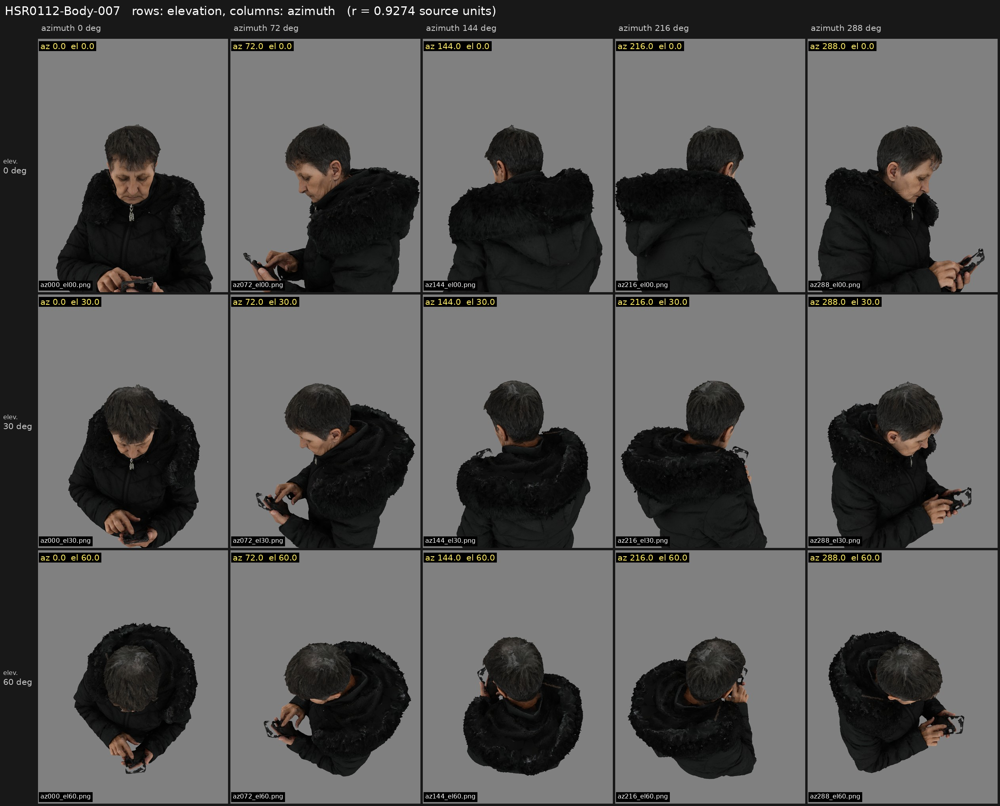
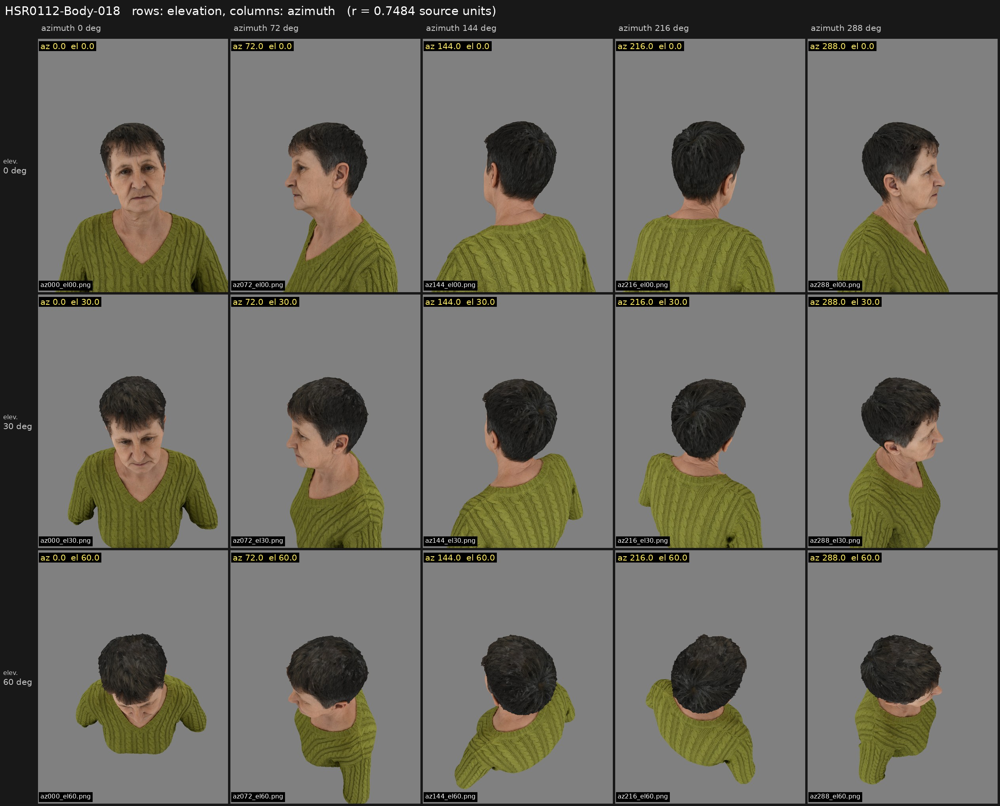
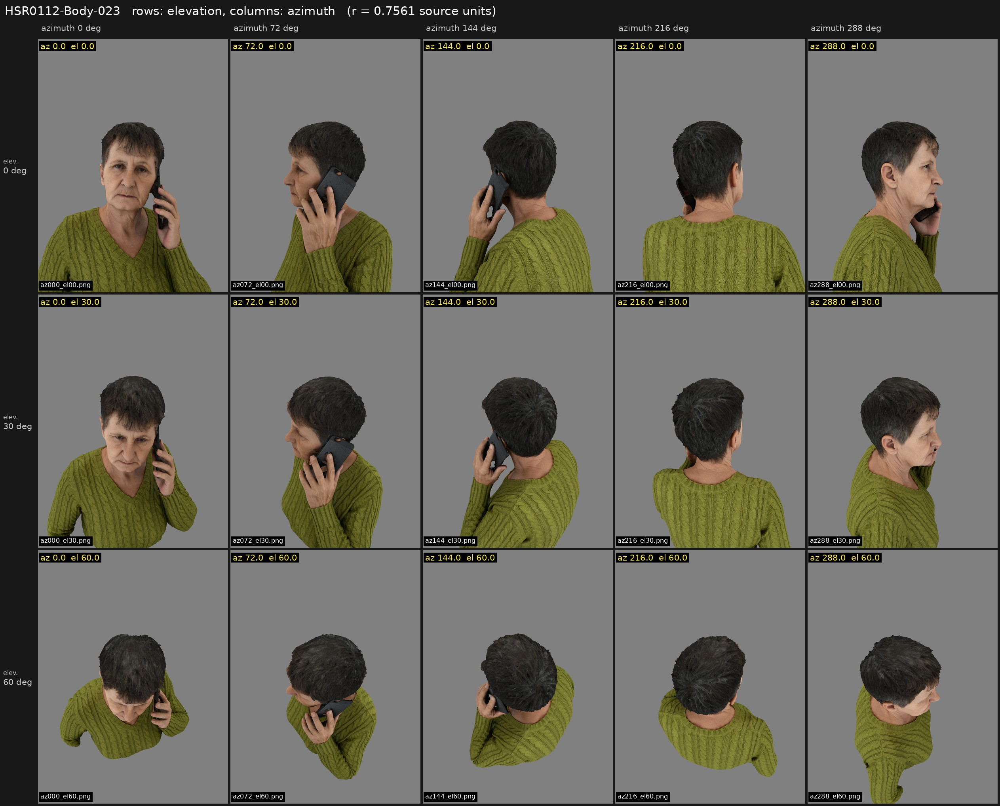
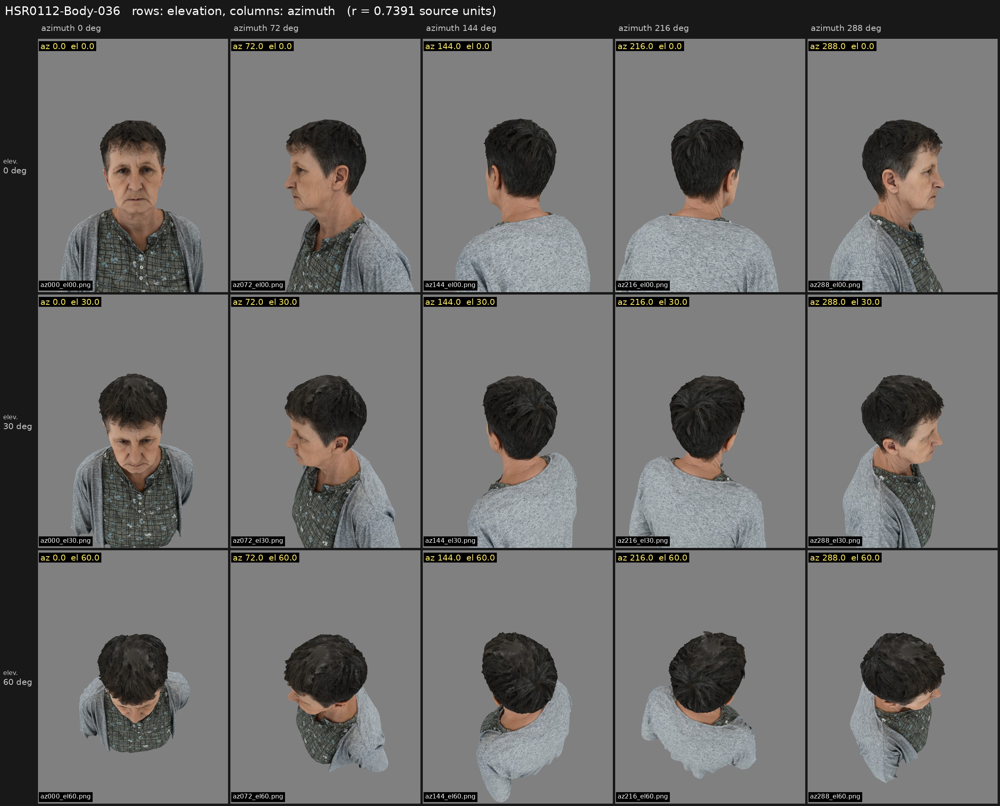
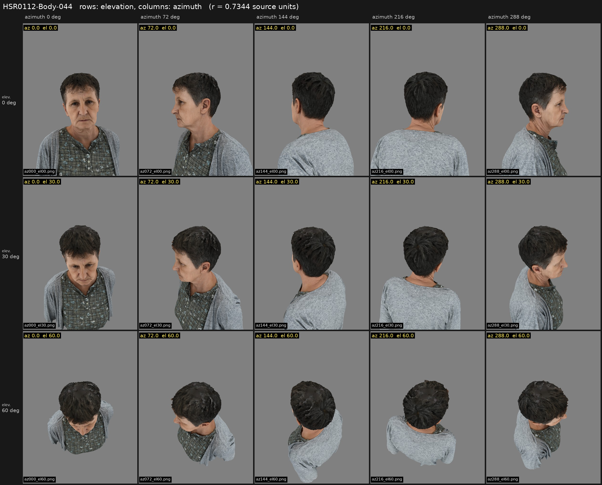
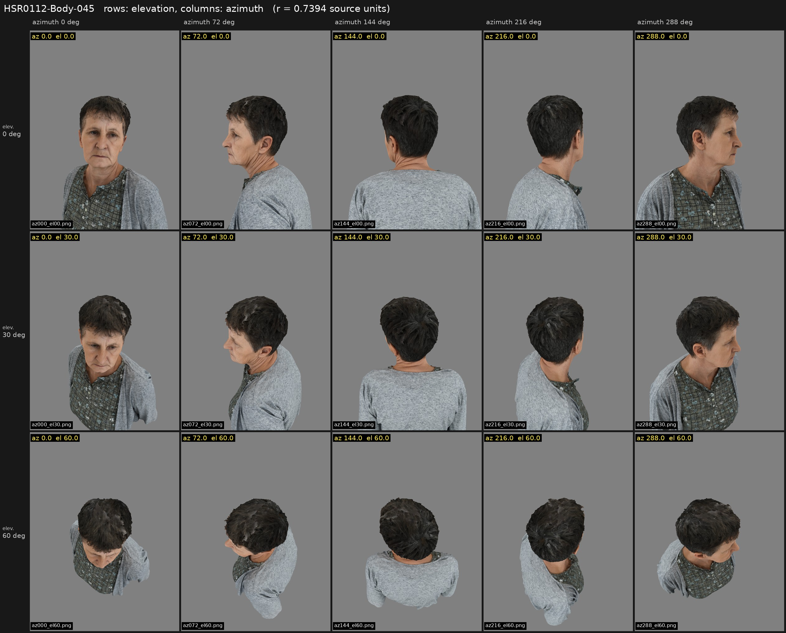
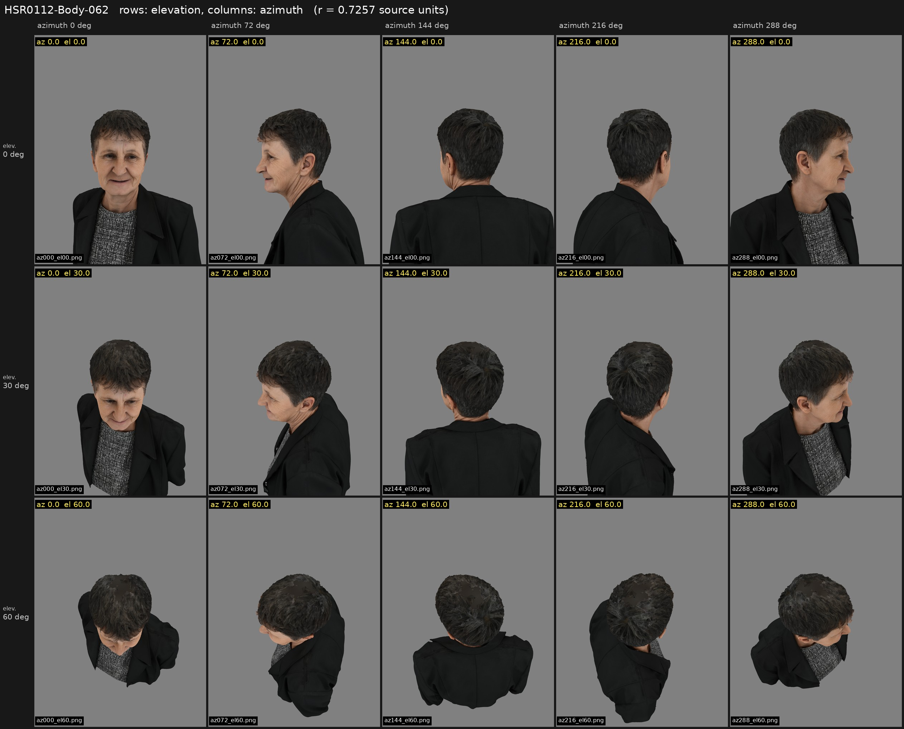
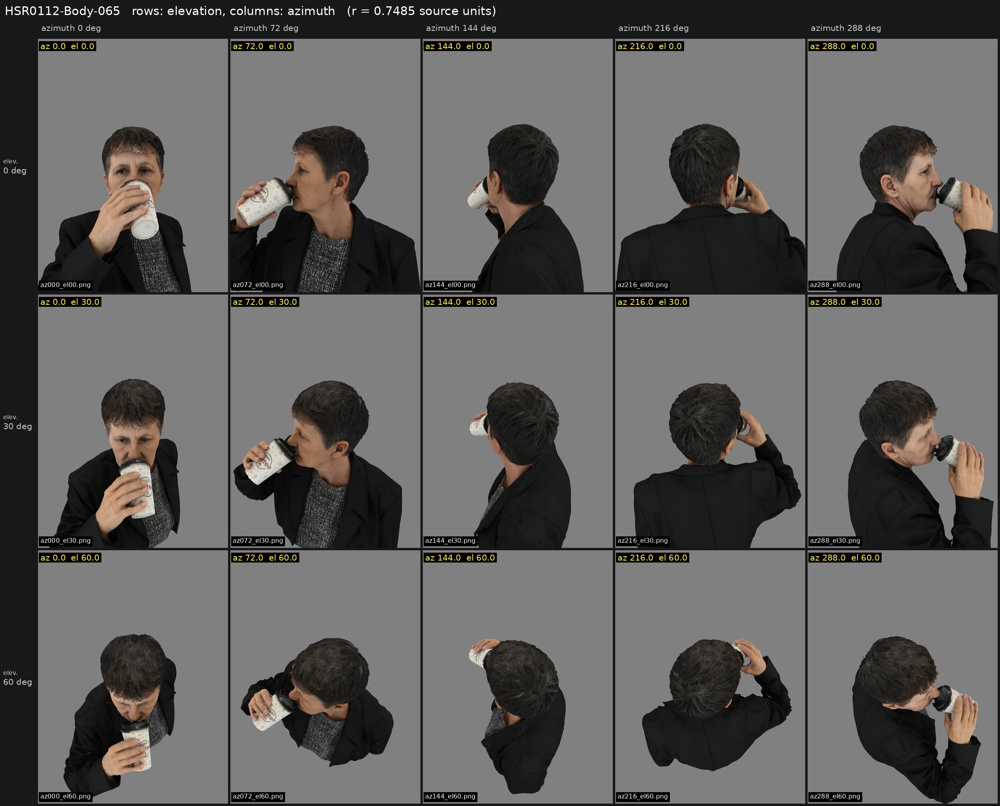
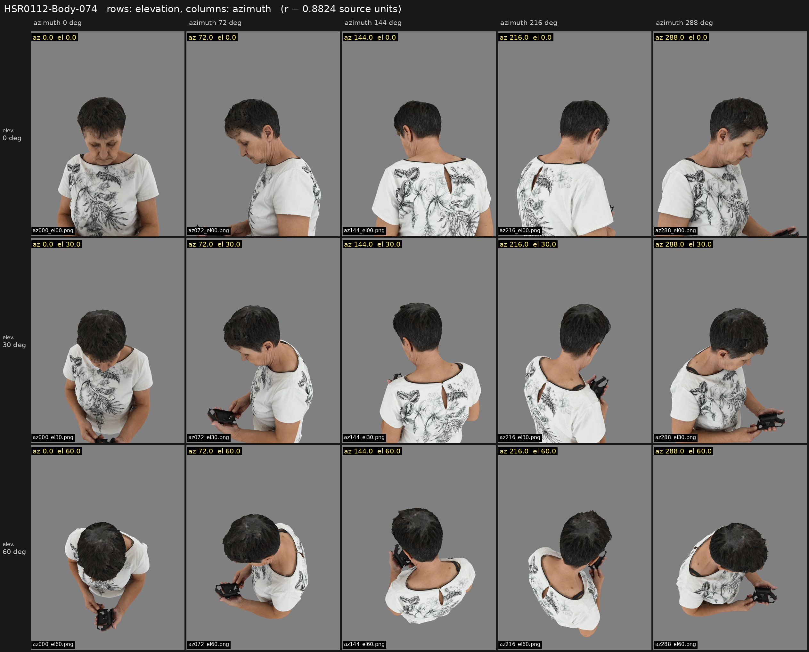

# HSR0112

[← 전체 목록](../README.md)

3D 스캔 9개, 이미지 135장. 그림을 누르면 그 스캔의 개별 이미지로 갑니다.

## [HSR0112-Body-007](HSR0112-Body-007/README.md)

## [HSR0112-Body-018](HSR0112-Body-018/README.md)

## [HSR0112-Body-023](HSR0112-Body-023/README.md)

## [HSR0112-Body-036](HSR0112-Body-036/README.md)

## [HSR0112-Body-044](HSR0112-Body-044/README.md)

## [HSR0112-Body-045](HSR0112-Body-045/README.md)

## [HSR0112-Body-062](HSR0112-Body-062/README.md)

## [HSR0112-Body-065](HSR0112-Body-065/README.md)

## [HSR0112-Body-074](HSR0112-Body-074/README.md)

