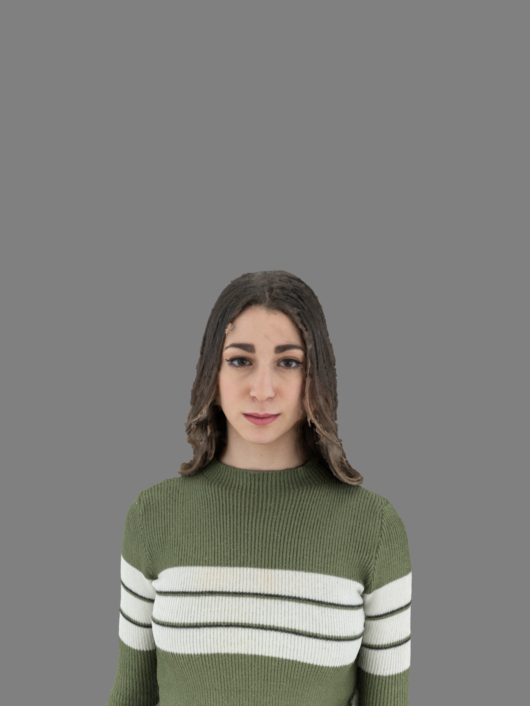
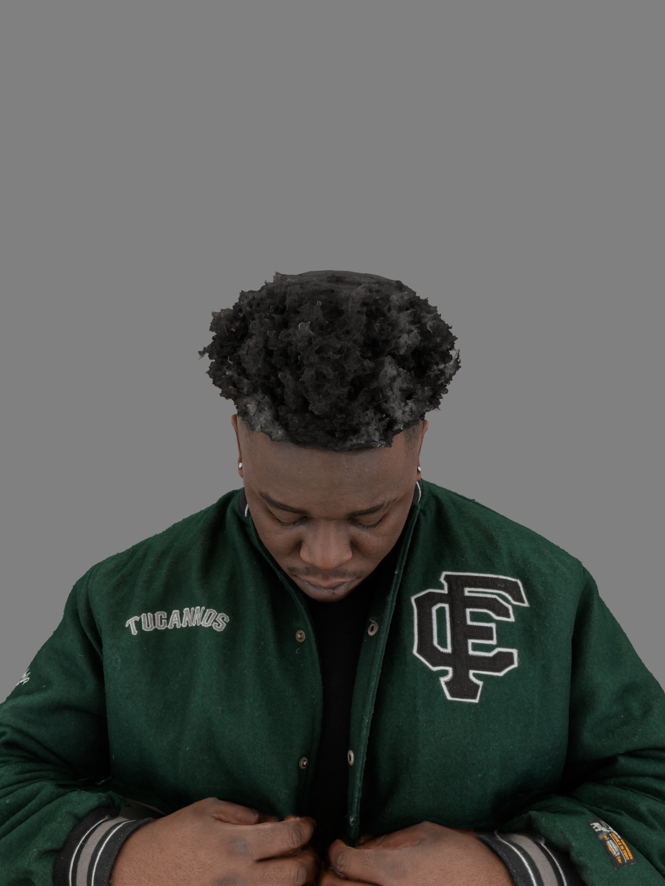
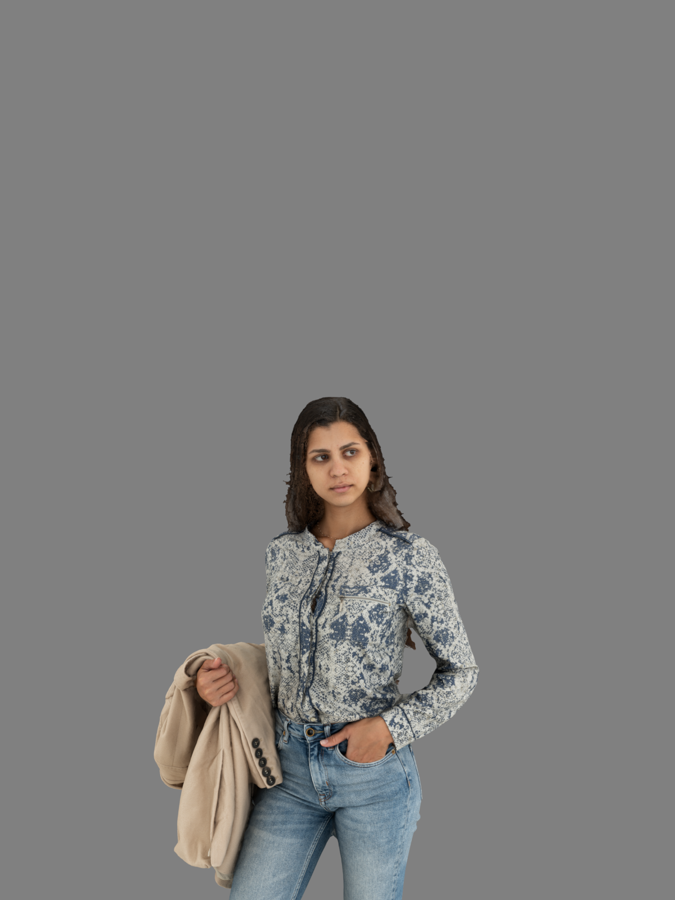
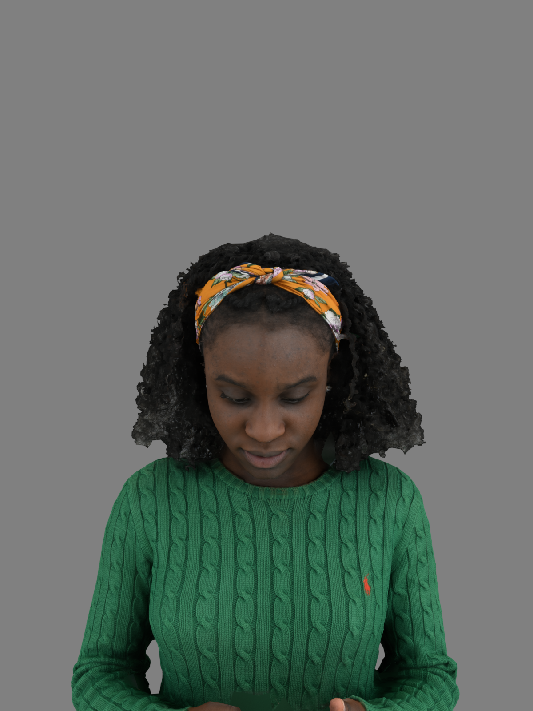
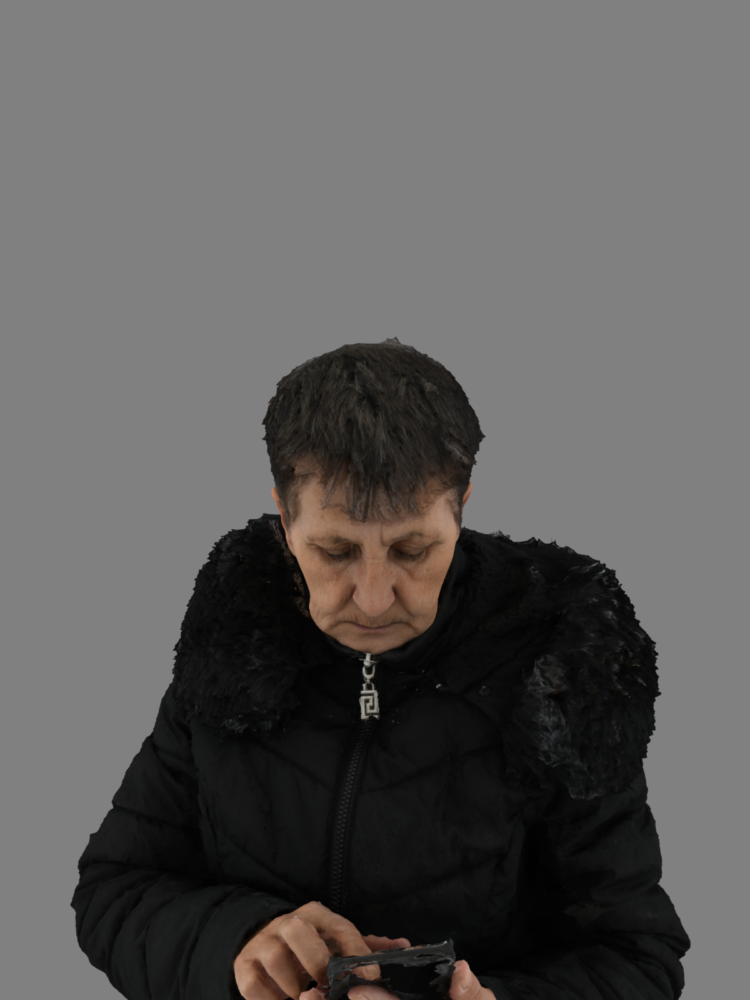

# HSRD-100 머리 다시점 이미지 (3D 스캔 ↔ 2D 이미지)

[HSRD-100](https://huggingface.co/datasets/digitalrealitylab/HSRD-100) 의 전신 3D 스캔을 머리 중심으로 렌더링한 2D 이미지입니다. 3D 스캔 **69개**(사람 9명)마다 **15장**씩, 모두 **1,035장**(1200×1600 PNG)입니다.

## 사람별 목록

사람을 누르면 스캔별 15시점 모음을 볼 수 있습니다.

| 사람 | 정면 예시 | 3D 스캔 | 이미지 |
|---|---|---|---|
| [**HSR0015**](HSR0015/README.md) | <a href="HSR0015/README.md"></a> | 8 | 120 |
| [**HSR0023**](HSR0023/README.md) | <a href="HSR0023/README.md"></a> | 10 | 150 |
| [**HSR0027**](HSR0027/README.md) | <a href="HSR0027/README.md"></a> | 6 | 90 |
| [**HSR0028**](HSR0028/README.md) | <a href="HSR0028/README.md"></a> | 8 | 120 |
| [**HSR0040**](HSR0040/README.md) | <a href="HSR0040/README.md"></a> | 9 | 135 |
| [**HSR0042**](HSR0042/README.md) | <a href="HSR0042/README.md"></a> | 3 | 45 |
| [**HSR0081**](HSR0081/README.md) | <a href="HSR0081/README.md"></a> | 7 | 105 |
| [**HSR0102**](HSR0102/README.md) | <a href="HSR0102/README.md"></a> | 9 | 135 |
| [**HSR0112**](HSR0112/README.md) | <a href="HSR0112/README.md"></a> | 9 | 135 |

원본 100개 스캔 중 31개는 뺐습니다(모자 착용 27, 텍스처 누락 4). 머리카락 형태를 보려는 데이터라 모자를 쓴 스캔은 넣지 않았습니다.

## 폴더 구조

```
matching.csv                 이미지 한 장마다 대응하는 3D 스캔과 시점
dataset_manifest.json        전체 목록과 제외 사유
attribution.txt              출처·라이선스
<사람 ID>/<3D 스캔 ID>/
  images/                    2D 이미지 15장 (az000_el00.png … az288_el60.png)
  contact_sheet.jpg          15장을 한 장에 모은 그림
  cameras.json               15개 시점의 카메라 내부·외부 파라미터
  source.json                원본 3D 스캔의 URL·해시
  model_config.json  qa_report.json  camera_layout.png 렌더 설정·검수 기록·카메라 배치도
```

## 2D 이미지와 3D 스캔의 매칭

* **폴더 이름이 3D 스캔 ID 입니다.** 예를 들어 `HSR0015/HSR0015-Body-023/images/` 의 15장은 `HSR0015-Body-023-Scan-LOD0.zip` 을 렌더링한 것입니다.
* **[matching.csv](matching.csv)** 에 이미지 1,035장 각각의 3D 스캔 파일, 다운로드 URL, sha256, 수평각·고도각이 한 줄씩 있습니다.
* **`cameras.json`** 의 `K`(내부)와 `w2c_opencv`(외부)로 3D 점을 이미지 픽셀에 투영할 수 있습니다. 좌표는 머리 중심을 원점으로 정렬한 좌표계이고, 원본 스캔 좌표와의 변환은 `source_to_aligned` 입니다.
* **3D 원본**은 `matching.csv` 의 `scan_url`(Hugging Face 의 [HSRD-100](https://huggingface.co/datasets/digitalrealitylab/HSRD-100))에서 받습니다.

## 파일 이름

`az<수평각>_el<고도각>.png` 입니다. 고도각은 0°, 30°, 60° 이고 0° 가 눈높이, 클수록 위에서 내려다봅니다.

| 수평각 | 카메라 위치 |
|---|---|
| 0° | 정면 |
| 72° | 피험자의 왼쪽 앞 |
| 144° | 피험자의 왼쪽 뒤 |
| 216° | 피험자의 오른쪽 뒤 |
| 288° | 피험자의 오른쪽 앞 |

## 출처와 라이선스

원본 스캔: *HSRD-100: 100 High-Quality 3D Human Scans Dataset, Digital Reality Lab (2025)*, <https://huggingface.co/datasets/digitalrealitylab/HSRD-100>, [CC BY 4.0](https://creativecommons.org/licenses/by/4.0/). 이미지는 원본 스캔을 렌더링한 2차 저작물이며, 자세한 내용은 [attribution.txt](attribution.txt) 에 있습니다.

원 데이터셋 카드는 개인 식별(생체 인식)·의료 진단·감시 목적의 사용을 허용 범위 밖으로 명시합니다. 이 이미지도 같은 조건으로 사용해 주세요.
